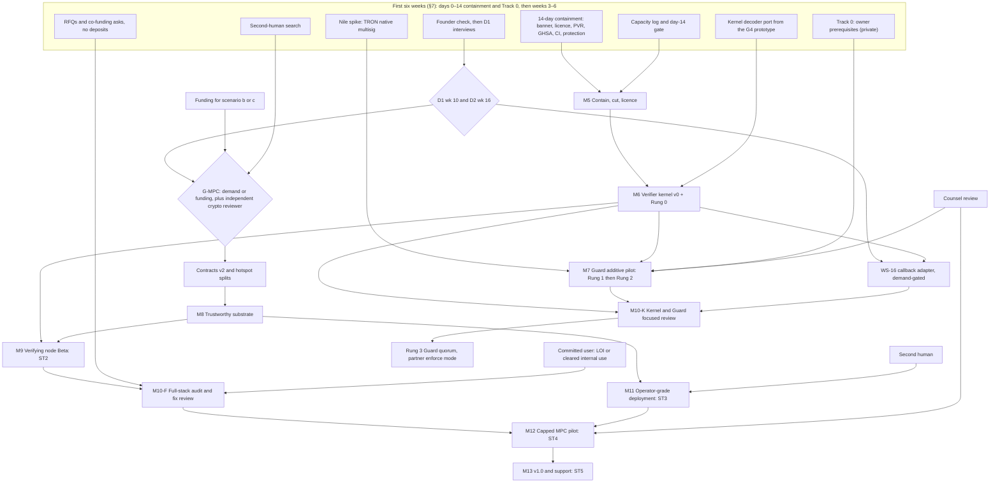

# Vaultex Production Roadmap

| | |
|---|---|
| **Date** | 2026-10-09. Week numbers count from **wk 0 = Monday 2026-10-12**. |
| **Baseline** | `dev` @ `ccd1f7f6` (last commit 2026-06-01; no commits for 130 days). Re-checked read-only today: no `LICENSE*` file, 74 tracked files under `.agents/`, three author identities in history (537 / 18 / 7 commits). |
| **Status** | **PROPOSED, awaiting owner decisions (§11).** Replaces `docs/ROADMAP.md` (35 lines, last updated 2026-04-01, stale). Every date and effort figure is an ESTIMATE; re-plan at wk 6 from measured throughput. |
| **Public safety** | Written for the public repo. Vulnerabilities appear only as *category + fix*. Business details of the internal first user, names or locations of secrets, outreach targets, and exploit mechanics live in `PRIVATE_NOTES.md`, which is not public. |
| **Provenance** | Synthesised from five round-2 proposals (P1 trust-first, P2 value-first, P3 licensed-custodian wedge, P4 OSS verifying signer, P5 delete-first minimal) and three judges (J1 security, J2 operator, J3 market; their outputs are saved verbatim as `J1-security.md`, `J2-operator.md` and `J3-market.md`). **Base: P4** (chosen by J1 and J3), with grafts from all three judges, including J2's additive "value-first" ladder. |
| **Evidence convention** | **[I#], [M#], [G#] and ledger IDs** (S1–S8, W1–W17, O1–O11, T1–T10: the round-2 verified claims ledger, Appendix A) mean **VERIFIED** by that source's evidence. **[P#] and [J#] record the provenance of a design choice, not evidence**; where a fact rests on a P- or J-paper, the primary source it recorded is named (for example "counter output recorded in P5 §4"). **HYPOTHESIS** means unproven; the cheapest test is named. **ESTIMATE** means effort, cost or time, with its basis. **[needs counsel]** marks a legal question. **IDs never collide:** stages are ST0–ST6 (§1.1); B1–B8 are the Beta exit criteria (§1.1); audit lines follow G7 §9.2 as AL1 integration audit, AL2 fix review, AL3 library-delta review, AL4 decoder/encoder review and PT1 pentest; risks are RK1–RK10 (§10); R0–R10 are agent roles (§9.1); M10-K is the Tier 1 review and M10-F the Tier 2 audit; milestones M5–M13 are new (§1.4), while bracketed [M1]–[M8] are market reports. Round-1 reports (I1–I11, M1–M8, G1–G8) and round-2 papers (P1–P5, J1–J3) sit in the project's private research archive; Appendix B indexes them. |

---

## 0. Executive summary

### Where we are

- **Stage verdict: ST0→ST1 (pre-alpha).** I9 rated Vaultex Alpha under its unrefined model; this roadmap's ST1 also requires truthful public claims, which M5 delivers. Per subsystem: encoders ST1/TRL 5; integrated system TRL 4.
- **What works:** the chain encoders are real. They are pinned byte-for-byte to official SDK output and confirmed on six public testnets (TRL 5) [S4; I9 §3.3].
- **What blocks value:** the integrated custody system is TRL 4 and cannot hold value. The hand-rolled threshold-ECDSA engines are unsound by design and fail every signature at production parameters [W1, W2]; key-generation secrets cross an unauthenticated message bus [W4]; the control plane can be replayed [W5]; the gateway asserts a policy that no signer checks [W3]; state lives in memory, with no backup and no working multi-host deployment [W8, W9, W16]; and there is no LICENSE file, no external review, and one maintainer who has not committed for 130 days [W6, W7].

### Five decisions (§11)

1. **Commit capacity and recruit a second human** (ADR-01, by day 14): at least 16 measured owner review hours a week by day 14, plus 7–13 hours a week for discovery, assurance and counsel (§4.2), and a contract applied cryptographer; without that person MPC custody is out of reach and the plan honestly stops after Phase 1.
2. **Contain the public repo within 14 days, and delete rather than quarantine the unsafe cryptography** (ADR-02 licence, by day 3; ADR-03 deletion and ADR-13 disclosure, by day 7): a MIT OR Apache-2.0 licence once every author identity has consented (or the recorded day-30 fallback applies), a truth banner, private vulnerability reporting, a category-level advisory, and CI that cannot pass with failing tests.
3. **Bet on one thing, an open verifier kernel that every signer runs** (ADR-04, by day 7): each signer decodes the exact transaction, recomputes the digest, enforces a quorum-signed policy and k-of-n approvals, and emits signed receipts, TRON-first on one adopted engine (pinned LFDT-Lockness `cggmp24` [S1]), because veto hooks are table stakes while the open every-signer combination may be unoccupied [T6; G5 §7].
4. **Adopt a real-funds rule by mode** (ADR-05 and ADR-06, by day 7): additive mode, where a Vaultex-held key cannot move funds alone, may carry capped own funds before an audit; any mode where Vaultex-held keys alone can move funds carries at most a $1,000 canary until an auditor's fix-review letter; and no third-party funds move before an audit, two humans and counsel.
5. **Gate money on evidence** (ADR-07, by wk 16; ADR-08, by wk 2 / D2): at least 4 concrete intents from at least 12 interviews by wk 10, and a signed LOI by wk 16, decide whether the MPC engine swap and the paid audit happen; RFQs go out in wk 2, while deposits wait for a committed user.

### Plan (all dates are ESTIMATES, §4)

- **Phase 1, solo-feasible (≈ 20–25 engineer-weeks):** M5 contains, cuts and licenses the repo; M6 ships the kernel as a standalone crate; M7 runs it as an additive co-signer on a capped TRON native-multisig float, with first real funds around wk 27–34 solo. **Gates:** the day-14 gate, the M6 independent review, and RF-1 before any real funds.
- **Phase 2, only if demand or funding exists:** M8 rebuilds the substrate on `cggmp24` with encrypted, identity-pinned transport, and M9 puts the kernel in every MPC node (testnet Beta). **Gate:** G-MPC (D1/D2 or funding, plus an independent crypto reviewer).
- **Phase 3:** M10–M13 buy independent assurance, an operator-grade deployment, a capped MPC pilot and v1.0. The capped MPC pilot lands around wk 52–66 with a contract cryptographer or wk 39–48 with a team of three, and is not reachable solo. **Gate:** the auditor's fix-review letter (RF-2, RF-3), plus a second human and counsel.

**At a glance (ESTIMATES; §4.2 has the capacity model).** Scenario (a) assumes 16 h/week of owner review from wk 2, plus 7–13 h/week for WS-14/15/17; (a) intervals scale by 16 ÷ measured review hours.

| Milestone | (a) solo + agents | (b) + contract cryptographer | (c) team of 3 |
|---|---|---|---|
| M5 repo contained, cut and licensed | wk 6–9 (≈ Nov–Dec 2026) | wk 5–7 | wk 3–4 |
| M6 verifier kernel v0 | wk 19–25 (≈ Feb–Apr 2027) | wk 16–21 | wk 10–13 |
| **First additive real funds** (M7, Rung 2 Phase A) | **wk 27–34 (≈ late Apr–early Jun 2027)** | wk 23–29 | wk 14–18 |
| M9 MPC testnet Beta (ST2) | not scheduled | wk 36–45 | wk 22–27 |
| M12 capped MPC pilot (ST4) | not reachable without a second human | wk 52–66 (≈ Oct 2027–Jan 2028) | wk 39–48 (≈ Jul–Sep 2027) |

---

## 1. Where we are

### 1.1 Stage model ST0–ST6 (I9 §3.2, refined)

A stage applies **per product line and per declared support matrix**, not to the whole repo. Refinements to I9's model are marked **(R)**. Every criterion closes only on an artifact: a CI run URL, a transaction hash, a drill log or a report.

| Stage | Exit criteria |
|---|---|
| **ST0 Prototype** | Core algorithms produce verifiable signatures in process. |
| **ST1 Alpha** | Every claimed feature exists as tested library code, the architecture is chosen and CI exists. **(R)** Public claims match the code: a banner, a support matrix and a claims ledger. |
| **ST2 Beta (testnet)** | **B1 (R)** Every claimed custody control is enforced **at each signing node**, not only at the gateway, with a negative E2E test per control.<br>**B2 (R)** Distributed keygen and signing run on ≥ 3 processes across ≥ 2 hosts **at production parameters only**, with 0 skipped critical tests and 50 consecutive green runs.<br>**B3** An automated testnet broadcast runs through the production path for every supported chain.<br>**B4** All operational state survives a restart.<br>**B5** Release engineering: one version scheme, signed tagged releases, LICENSE, and a changelog tied to tags.<br>**B6** `cargo audit`/`cargo deny` are green; any exception is owner-signed and expires.<br>**B7 (R, new)** Adversarial evidence: the compromised-gateway harness yields 0 out-of-policy signatures, the transport adversarial suite is green, and refusal tests are mutation-checked.<br>**B8 (R, new)** Truthful claims: claims-lint is green and every public claim maps to an artifact. |
| **ST3 Production Candidate** | External audit plus pentest with every Critical and High fixed and re-verified by the auditor. **(R)** The audit scope includes the library-delta review (audit line AL3) and the decoder and policy kernel (audit line AL4). Branch protection with human review on trust paths, and **(R)** a second accountable human. Key ceremony, backup/restore and node-replacement drills. KEKs in KMS/HSM, with **(R)** distinct per-node secrets and failure domains. SLO monitoring, game-day-tested runbooks, SBOM and signed releases. |
| **ST4 Limited Production** | Mainnet behind hard caps. ≥ N weeks with zero Sev-1. On-call proven, bug bounty live, counsel review for the jurisdiction, written risk acceptance. **(R)** An independent outflow monitor in a third failure domain, with an auto-freeze drill in ≤ 60 s. **(R)** ≥ 2 humans operate nodes, and no single person holds t node credentials. **(R)** The real-funds rule by mode (§3.4) holds. |
| **ST5 GA** | Semver API guarantees, published crates/SDKs, support/SLA, SOC 2 Type I if sold to regulated buyers. **(R)** ≥ 2 maintainers and a supported-versions policy. |
| **ST6 Scale** | HA/multi-region, HSM/TEE share protection, SOC 2 Type II / ISO 27001, throughput and latency SLOs. |

### 1.2 Placement by subsystem, with TRL

| Subsystem | Stage today | TRL | Evidence |
|---|---|---|---|
| Chain encoders (6 live testnet chains, incl. TRC-20) | ST1, component-validated | 5 | 9 SDK reference-vector tests; testnet transactions re-confirmed on-chain 2026-10-08; 0 mainnet transactions [S4; I9 §3.3] |
| Hand-rolled threshold ECDSA (GG20, CGGMP21, Stark) | **Below ST1.** Non-functional at production parameters and unsound by design. Retire | n/a | 10/10 production-parameter signs abort; key-extraction-class design flaws [W1, W2; I1; I7; G3] |
| FROST (ZF library wrappers) | ST1 | 4 | The only scheme that signs on the real gateway→bus→node path. Keygen is flaky and round-2 shares cross the bus in cleartext [S5; G3] |
| Replacement engine (`cggmp24`, pinned) | ST0 (a spike outside the main code) | 4 | 2-of-3 at production parameters over Vaultex's own transport, single host [S1; G1] |
| Node-side verification kernel | ST0 (a prototype in a scratch clone) | 3–4 | 14/14 tests including tamper cases; µs–ms cost [S2; G4] |
| Transport, DKG and control plane | ST1 with blocking defects | 4 | Keygen secret material is recoverable by a passive bus observer, sender identity is spoofable, and control messages are replayable, all demonstrated in an isolated lab [W4, W5; G3] |
| Authorization (policy, approvals, velocity, audit) | ST1, library only, not enforced | 3 | The gateway asserts the policy result; nodes do not decode what they sign [W3; G4 §1] |
| Gateway state and transaction lifecycle | ST1 | 4 | In-memory registry (a restart lost every wallet in a live test); no transaction object [W9; G3] |
| Key lifecycle (backup, restore, refresh, failover) | Absent | — | [W8] |
| Deployment and operations | Below ST1 | 3–4 | No shipped artifact starts a working multi-host cluster [W16; I5] |
| CI, release and supply chain | Fails B5/B6 | — | CI can pass with failing tests; Release failed 20/20; 4 RUSTSEC advisories; no branch protection [W11, W13] |
| Open-source adoptability | Not adoptable | — | No LICENSE, unpublished crates, crate name taken [W7] |
| Assurance | None external | — | All past "audits" were by an internal AI agent; 25 of 25 PRs merged unreviewed [W6, W14] |
| **Integrated system** | **ST0→ST1 (ST1 after M5).** B1–B6 none met (B3 partial, via the single-process CLI only) | **4** | I9 rated it Alpha under the unrefined model; ST1's truthful-claims criterion fails today [W14] [I9 §3.2–3.3] |

I9 rated the "crypto + chain-encoder subsystem" TRL 5. This roadmap splits that rating: the encoders are TRL 5, but the ECDSA engines' testnet evidence used shared test parameters in a single process, so it does not transfer to production [W13].

### 1.3 Health signals (VERIFIED)

- **Activity and test signals:** no commits since 2026-06-01. A CI-equivalent run passes 994 tests, but with test-only crypto parameters [S7; W13].
- **CI and release:** `main` CI failed 28 of 93 runs, and the last run is red. The release workflow auto-tags on every push to `main` and has failed 20 of 20 runs [W11].
- **Dependencies:** `cargo audit` reports 4 advisories and 9 suppressed ones, and the lockfile pins a yanked safe-prime crate [W11].
- **Public exposure:** the repo is public, with 2 forks and about 9 unique cloners in 14 days. Its README still says "Production-ready infra", and private vulnerability reporting is off [T5; O10].

### 1.4 Honest re-baseline of milestone history

M5–M13 below are new; the withdrawn 2026-03 milestones are cited as M5(2026-03)…M8(2026-03).

| Milestone (defined 2026-03-19) | Declared | Ground truth | Re-baselined status |
|---|---|---|---|
| M1 Security hardening | "Done" 03-19 | Control messages are signed but carry no freshness; the "audit clean without ignores" criterion is unmet | **Partial** [I9 §2.2; W5] |
| M2 CGGMP21 | "Done" 03-19 | Library completed about 10 days *after* the declaration. Now known to be unsound and to fail at production parameters | **Void.** Superseded by `cggmp24`; code to be deleted [W1, W2] |
| M3 HSM/SGX | "Done" 03-19 | KMS signer and client are stubs; the only enclave is a mock | **Not met** [I9 §2.2] |
| M4 Policy v2 & delegation | "Done" 03-20 | Library only, not enforced on the sign path. The signed-policy type fails verification after a JSON round trip in 194 of 200 runs | **Library only.** Replaced by the kernel's policy bundle v1 [W3; G4 §3.2] |
| M5(2026-03)–M8(2026-03) (DeFi screening; multi-tenant/webhooks; compliance & external audit; launch) | Deleted from the roadmap on 2026-04-01 | None delivered. Fragments exist: unwired webhooks, audit-prep documents, a Helm chart that cannot start a cluster | **Withdrawn**; content re-planned below [I9 §2.1–2.2] |
| Process facts | "52 sprints" | 18 active days; 562 commits; M1–M4 declared within 8.7 hours with 10 of 75 exit criteria ticked; internal security gate inactive after 2026-03-20 | Milestones now close **only on artifacts** (§9) [S8; I9 §2] |

---

## 2. What "production" means for Vaultex

### 2.1 Declared v1 scope and boundary

- **v1 support matrix.** A self-hosted 2-of-3 threshold signer for **TRON (TRX + TRC-20)** on **pinned `cggmp24`** (full interactive signing; no presignatures), in which **every node independently verifies what it signs**. EVM is next, on the same engine. Everything else is quarantined (§3.5).
- **Caller-builds boundary** [P5 §3.1]. The caller builds and broadcasts transactions; Vaultex receives untrusted unsigned bytes and refuses anything it cannot verify. Fee and energy management, deposits, sweeps, broadcast and confirmations are the operator's responsibility in v1, and the docs must say so.
- **Additive product line ("Guard").** The same kernel runs as a required co-signer beside the operator's key on a TRON native-multisig account (§3.4). It has its own production bar (§2.4).

### 2.2 ST3 Production Candidate: checkable criteria (MPC line)

| ID | Criterion | Evidence artifact | Milestone |
|---|---|---|---|
| PC-01 | Only pinned `cggmp24` is reachable in release builds. Legacy engines are deleted. A release build that links test parameters fails to compile or refuses to start | CI shipped-build guard run; LOC diff | M5, M8 |
| PC-02 | Production-parameter E2E on ≥ 2 hosts: 100/100 signatures verify with `k256`/`ecrecover` across all three signer subsets; 50 consecutive green runs | CI run URLs + harness log | M8 |
| PC-03 | The transport adversarial suite is a required job: spoofed sender, replayed execution id, cross-session replay, oversize message rejected before parsing, dropped message retried with a fresh execution id, and an unprivileged bus client that reads no peer-to-peer plaintext. The round number is checked and filtered for any non-round-based protocol (FROST on re-entry). The G3 live checks are re-run as regressions | CI run | M8 |
| PC-04 | Control plane v2: nonce, expiry and subject binding; a persisted replay cache; keygen never overwrites an existing group; node replies are signed and checked for party uniqueness and address continuity; the returned signature is verified against the group key | Tests + CI | M8 |
| PC-05 | Every node decodes, recomputes the digest, verifies the quorum-signed bundle, k-of-n approvals and the initiator signature, reserves velocity, writes a signed receipt, and only then signs. Raw-digest signing does not exist | Tests; receipt verifier output | M9 |
| PC-06 | Compromised gateway plus one compromised node: 0 out-of-policy signatures, and outflow under subset rotation stays ≤ (n−c)·L | Harness report | M9 |
| PC-07 | The gateway is rebuilt from signed node registries, and node state survives `kill -9` | Restart test | M9 |
| PC-08 | Any t of n nodes sign with node 1 down. Bursts of 2 requests in 1 s, and 13/min for 10 min, produce 0 silent drops. p50/p95 at production parameters are published | Load-test report | M9 |
| PC-09 | Key store v2 (AAD-bound, atomic fsync'd writes, refuses overwrite). Per-node KMS- or PKCS#11-wrapped KEK. Distinct per-node secrets, accounts and failure domains | Config evidence; crash test | M8, M11 |
| PC-10 | Customer-held encrypted backups plus an offline restore tool. A restore drill and a node-replacement drill (new DKG + sweep) | Drill logs + tx hashes | M11 |
| PC-11 | Ceremonies: ≥ 2 humans confirm node-signed {wallet, pubkey, address} attestations out of band; the transcript is signed | Transcript | M9, M11 |
| PC-12 | External assurance, audit lines: AL1 integration audit + AL2 fix review + AL3 `cggmp24` library-delta review (mandatory) + AL4 decoder review + PT1 pentest. Scope names the gateway routes, decoders, policy kernel, transport, key store, and backup/restore/recovery tooling | Auditor's fix-review letter; public report | M10-F |
| PC-13 | Release integrity: cosign-signed reproducible releases, SLSA provenance, CycloneDX SBOM, SHA-pinned Actions, `cargo-deny` + `cargo-vet` on crypto crates, 0 open RUSTSEC | Release page; CI | M5, M11 |
| PC-14 | Governance: branch protection, CODEOWNERS human review on trust paths, a second human reviewer, claims-lint green | Protection API output; CI | M5, M11 |
| PC-15 | Monitoring of refusal rate, breaker state, quorum at risk and velocity headroom. Runbooks game-day tested | Dashboard export; drill logs | M11 |

### 2.3 ST4 Limited Production: checkable criteria

| ID | Criterion |
|---|---|
| PL-01 | Counsel opinion on the pilot arrangement in its jurisdiction [needs counsel] |
| PL-02 | Before the fix-review letter, at most a **$1,000 project-owned canary**. After it: Phase A (≥ 14 days) then Phase B (≥ 30 clean days) under hard caps. Caps rise only after 30 clean days, one freeze drill and one restore drill |
| PL-03 | ≥ 2 independent humans operate nodes, no single person holds t node credentials, and on-call is staffed by ≥ 2 humans |
| PL-04 | An independent outflow monitor runs in a third failure domain. Every outflow must match a receipt. An auto-freeze drill completes in ≤ 60 s |
| PL-05 | ≥ 30 consecutive days with zero Sev-1, a private bug bounty live, and an incident-response plan with receipt export for forensics |
| PL-06 | Third-party or client funds only after an audit with fix review, ≥ 2 humans and counsel, and then the partner's own house funds first, under the partner's written risk acceptance |

### 2.4 Additive-mode bar (Guard, Rung 2)

A Guard defect alone cannot move funds, because the chain requires both signatures. So the bar is **RF-1 plus RF-4** (§3.4) rather than ST3:
- an independent human code review, by someone who is neither the author nor an AI agent;
- the adversarial harness green, with mutation checks;
- a signed reproducible release;
- written risk acceptance with a loss budget;
- counsel review of the arrangement;
- an independent outflow monitor;
- a project-owned float by default.

Any **substitutive** use (Rung 3), where Guard keys alone control the float, needs M10-K first [J2].

### 2.5 The market's production checklist, mapped to v1

The market production checklist [M7] lists 52 items, 33 of them P0, for a production-grade MPC stack. Vaultex fully meets none today and partially meets about 12 [M7 §7].

| Disposition | M7 items |
|---|---|
| **Covered by the v1 milestones** | M7-A1–A5 (audited engine, encrypted transport, KEK, customer-held backup, drills); M7-B1–B7 (node-enforced policy, no blind signing, approvals with separation of duties (SoD), admin quorum on policy, signer-side verification, allowlists, velocity and auto-pause); M7-B9; M7-C1 in part (idempotency at the nodes); M7-C4 (asset facts pinned in the bundle); M7-E1, E2, E5–E7; M7-F1, F2, F4, F5 |
| **Delegated to the caller in v1 (documented)** | M7-C2 fees and nonces, M7-C3 broadcast and confirmation, M7-C8 deposits, M7-C9 sweeps and TRON energy [P5 §3.1] |
| **Deferred, with a trigger** | M7-A6 refresh (upstream `cggmp24` has none; rotation = new DKG + sweep [T8]); M7-A8 HD deposit addresses; M7-B8 passkey approvers (Ed25519 hardware keys first); M7-C7 sanctions/KYT (via a compliance-approver key, on demand); M7-D1 webhooks; M7-D2 TS client (a thin helper only); everything in M7-G |

---

## 3. Strategy

### 3.1 Position against the market today

| Dimension | Vaultex today | Market reference | Evidence |
|---|---|---|---|
| Licence and openness | The whole stack, decision layer included, *could* ship under MIT OR Apache-2.0, but there is no LICENSE file | Fystack's nodes are open, but its policy backend (Apex) and SDK are closed. Fireblocks' MPC library is GPL and its co-signer closed. Cobo and Dfns signers are closed | [S6, W7, T5] |
| Crypto core | Hand-rolled ECDSA is unsound and broken; FROST comes via the ZF library; a `cggmp24` spike works | Audited libraries and vendor protocols. Inherited audits are thin and decaying | [W1, W2, S1, S5, T8] |
| Signer-side verification | Prototype only; today the gateway asserts the policy result | Veto hooks are table stakes. Decoding is left to customer glue. Per-share claims are closed | [S2, W3, T6, O2] |
| Transport | Leaks keygen secrets; sender identity is spoofable | mpcium has encrypted P2P since 2025-08 | [W4, T1] |
| Recovery | None | Recovery kits, escrow layers, and reshare with backups (mpcium) | [W8; M7 A4] |
| TRON | Encoders pinned to tronweb, including TRC-20, live on testnet | Supported by Fireblocks, Dfns, Cobo, Safeheron, BitGo, Fystack and Turnkey. Fee tooling is common, so a TRON operations module would only catch up | [S4, O8] |
| Vendor-blind | Yes: the customer runs every party | Not unique. Fireblocks' hosted-MPC option, Ledger on-prem and Dfns on-prem keep a vendor control plane; mpcium is fully self-run | [S3] |
| Assurance | None | Named audits, SOC 2 and bounties are table stakes | [W6; G7 §12] |
| Operations | No working multi-host artifact | Published SLAs and status pages | [W16; M7 §2.2] |
| Team | One dormant maintainer plus agents; very high code throughput | Fystack: 17 releases, active, bus factor ≈ 2 | [S8, W6, T1] |
| Price | n/a | Signature-priced hosted vendors win at small and mid volume. **Price is not the wedge** | [T9] |

Net position: today Vaultex is **weaker than Fystack mpcium with authorizers enabled** on every signer-side axis [T1; G5 §9]. Its real assets are byte-exact chain encoders, a sound hygiene baseline, a permissible dependency tree, a working `cggmp24` spike and a working verification prototype [S1, S2, S4, S6, S7].

### 3.2 Beachhead and positioning (evidence-backed; demand is HYPOTHESIS)

| Order | Who | What they get | Why (evidence) |
|---|---|---|---|
| 1 (now → M6) | Security engineers and the OSS/MPC community | Open specs (intent, policy bundle, receipt), the kernel crate, the red-team harness, incident-replay tests, upstream contributions | Losses moved to the decision layer: 7 of the 8 incidents of ≥ $100M in 2024–26 [T4]. Open-core vendors keep the decision layer closed [T5]. Regulators want reviewable vendor code [O9] |
| 2 (M6 → M10-K) | Operators who already run a vendor co-signer with callback hooks | The kernel as a **keyless, fail-closed callback gate**: shadow first, enforce later | Hooks default to open, and TRON decoding is left to customer glue [T6; G5 §5]. Incumbents own the disclosed demand, so add on rather than displace [T7]. Demand is a HYPOTHESIS (D1) |
| 3 (M7) | Operators who can use native multisig | The **Guard**: an additive co-signer on TRON native permissions | On-chain multisig is mainstream institutional custody [M1 §3.2]. One verifier, pluggable backends [J3]. Demand is a HYPOTHESIS |
| 4 (after M10-F + Tier 3 sell-to-licensees assurance, §8) | Licensed Thai custodians, brokers and exchanges; then Vietnam and Indonesia **through integrators** | Self-hosted verifying MPC stack plus demand-gated add-ons | Strongest evidenced pain: custodians score 18/21 and exchanges/brokers 17/21. The scores are a HYPOTHESIS on VERIFIED inputs [O1; G8 §6]. Buyers expect an audit, ISO/SOC 2, HSM, a cold tier, Travel Rule/KYT, escrow and 24/7 support first [G8 §7] |

**Not served now:**
- unlicensed TRON PSPs and OTC desks: they score 7/21 and are an enforcement target [G8 §6];
- embedded and consumer wallets [M2a];
- agent wallets [M2b; T10];
- buyers who want 50 chains;
- buyers who want a hosted SaaS or co-signer.

The 2027-02-27 Thai Travel Rule date is **not** used as a hook. No scenario delivers an audited product by then [T3].

### 3.3 The differentiator, precisely

| Table stakes (do not market) [G5 §6; T6] | Possibly unoccupied (HYPOTHESIS until the broader DD5 sweep [G5 §10]) [G5 §7.2] |
|---|---|
| A customer-controlled gate that can veto each signature | **Policy built into every share-holder**: n independent verifiers decode the same bytes and evaluate the same quorum-signed bundle, so a t-of-n signature implies t independent policy passes |
| Raw unsigned transaction delivered to that gate | **Open, native approver-signature verification** over a canonical, human-renderable intent, checked at every node, with SoD |
| A central policy engine (amounts, velocity, allowlists, quorum) | **TRON TRC-20 as a first-class decoder and policy path in OSI-licensed signer code** |
| Admin-quorum control of policy changes | **Verifiable signed decision receipts** from self-hosted nodes |
| Authenticated, encrypted inter-party messaging | **No single backend key with signing authority**, proven by a public red-team test |
| Third-party assurance | Cheap and credible: **fail-closed by default** (competitors' hooks default to open) and an **OSI-licensed decision layer** [T5, T6] |

**The claim Vaultex will earn** (publish only after M9, with its limits stated; adapted from P4 §1.1):

> For allowlisted transaction shapes on supported chains, no Vaultex signer contributes to a signature unless it has itself
> (1) decoded the exact unsigned transaction and recomputed the digest,
> (2) evaluated a policy bundle signed by a pinned quorum of policy administrators,
> (3) verified k-of-n approver signatures plus the initiator's signature, bound to the decoded intent,
> (4) reserved spend within its own velocity cap, and
> (5) written a signed, hash-chained receipt.
> A fully compromised gateway, or fewer than t compromised nodes, cannot obtain an out-of-policy signature.

**Limits:**
- **Context absent from the bytes.** Decimals, contract identity and network identity come only from the quorum-signed bundle, so there is **one key per network**; TRON, Solana, Sui and Bitcoin bytes carry no network id [S2].
- **Within-policy outflow is bounded, not zero.** It is bounded by L = ⌈t·G/n⌉, and by (n−c)·L with c non-enforcing nodes [G4 §4.5].
- **Common mode.** A kernel bug is shared by every node, so caps and auto-pause bound the loss (§10 RK4).

**Claims ladder:**

| When | May say |
|---|---|
| After M5 | "Unaudited, testnet-only research software. The hand-rolled ECDSA engines have been removed; any future ECDSA engine will be an adopted, audited library (decision gated by G-MPC)." Known limitations are published, and the README carries the canonical banner (M5 #1). |
| After M6 | "An open specification and kernel for signer-side verification (TRON), externally evaluated; reference node in progress; unaudited." |
| After M7 | "The kernel runs as an additive co-signer on a capped, project-owned mainnet float", plus a canary report. Not "production-ready". |
| At M7 (README banner) | The banner's "TESTNET ONLY" becomes: "Guard line: capped, project-owned mainnet pilot (unaudited); MPC line: testnet only." The rest of the canonical banner (M5 #1) stays until the relevant fix-review letter. |
| After M9 | The scoped claim above, for testnet, with its limits. Never "first" or "only". |
| After M10-F | "Independently audited by \<firm\> (report link), including the `cggmp24` library delta; pentested", for the exact support matrix. |
| Never until true | "production-ready", "50 chains", "TEE/HSM-protected", "SOC 2", "audited cryptography" without the audit-line-AL3 library-delta review, "MIT" without the file. Never misstate competitors: Fystack encrypts P2P, and its backend was audited [G5 §7.3]. |

### 3.4 One verifier, pluggable backends: the additive ladder and the real-funds rule

**TRON chain facts.** Primary source: developers.tron.network, the *Multi-Signature* and *Multi-signature example process flow* pages, fetched 2026-10-09 (readings recorded in P2 §3.2).
- **Permission ids:** owner 0, witness 1, active 2–9; each permission takes at most 5 keys.
- **Operations bitmap:** a 256-bit bitmap gates the contract types an active permission may sign. `AccountPermissionUpdate` (type 46) needs bit 46.
- **Fees:** parameter #22 is 100 TRX per permission update; #23 is a 1 TRX multi-signature surcharge.
- **What the chain cannot restrict:** destination, token contract, selector or amount. That is exactly what the Guard enforces.
- **Still a HYPOTHESIS:** on-chain co-signing under `Permission_id` 2. The Nile spike (wk 2–3, §7.2) tests it.

| Rung | Vaultex holds | Worst case if the verifier is wrong | Required first | Caps |
|---|---|---|---|---|
| **Rung 0: retro-shadow** | Nothing; reads public chain history of consenting accounts | None | M6 decoder + policy | n/a |
| **Rung 1: live shadow** | Nothing; decides and logs, always approves | None | Guard service (M7) | n/a |
| **Rung 2: additive co-sign** | One of two required keys. The active permission has threshold 2 (operator + Guard) and operations {1, 31}; the owner is a cold 2-of-3; `AccountPermissionUpdate` is never signable under active | Fails to block what the operator also signed, or false refusals (requests overflow to the operator's existing path) | **RF-1 + RF-4** (M7) | Phase A (≥ 14 days): ≤ 1,000 USDT/tx, float ≤ 10,000, ≤ 10,000/24 h, ≤ 30 tx/day. Phase B (≥ 30 clean days): ≤ 5,000/tx, float ≤ 25,000. Caps are ceilings; the float is the owner's written loss budget [P2 §4.2] |
| **Rung 3: Guard quorum (substitutive)** | All hot keys (2-of-3 Guards) | Loss ≤ float, bounded by caps, the monitor and (n−c)·L | **RF-2**: ≤ $1,000 canary until the **M10-K** fix-review letter. A second human holds ≥ 1 admin key and ≥ 1 owner key | Then Phase A → B → C, where C is the written loss budget |
| **Rung 4: MPC (substitutive)** | A `cggmp24` threshold key | Loss ≤ float; an integration bug could leak the key | **RF-2**: ≤ $1,000 canary until the **M10-F** fix-review letter, plus M11 and ≥ 2 humans | Phase A → B (→ C) |
| **Gate** (partners; keyless) | Nothing | False refusals | Shadow anytime; **enforce** (fail-closed, partner-controlled break-glass) only after M10-K reviews kernel + adapter | n/a |

If the Nile spike shows native co-signing unusable, the fallback **K-alt** applies: the Guard becomes a veto-only hook called by the operator's own signer. It is still additive [P2 §10.2].

**Track 0** means time-critical owner prerequisites outside this repository, in weeks 0–2; the checklist, with done-when evidence and owner sign-off, is `PRIVATE_NOTES.md` §5. Vaultex timelines assume it is done first, with only the containment rows (§7.1) running in parallel, and it gates any Rung-2 float that is not project-owned [P2 Track 0; J1].

**Real-funds rule by mode** [J1; adopted]:
- **RF-1. Additive mode** (a Vaultex-held key cannot move funds alone). Phase-A-capped funds are allowed before an external audit only when **all** of these hold:
  - Track 0 is done where it applies;
  - an independent human code review (not the author, not an AI agent);
  - the adversarial harness is green with mutation checks;
  - the release is signed and reproducible;
  - risk acceptance is written, with a loss budget;
  - counsel has reviewed the arrangement [needs counsel];
  - the float is **genuinely project-owned by default**; any other float needs written counsel clearance (decision record: `PRIVATE_NOTES.md` §7, ADR-06).
- **RF-2. Vaultex-held keys alone can move funds** (Guard quorum or MPC). Nothing beyond a **≤ $1,000 project-owned canary** until the auditor's fix-review letter for that mode.
- **RF-3. No third-party or client funds on Vaultex-held keys** before an audit with fix-review letter, ≥ 2 humans operating nodes, and a counsel opinion.
- **RF-4. Every real-funds stage runs an independent outflow monitor in a third failure domain.** Every outflow must match a receipt. TRC-20 `Approval` events and non-zero allowances from the float raise alerts, and every refill first checks that the allowance is 0, because an approval leaves a standing allowance that `transferFrom` can drain without another float signature (standard token semantics; approvals are a deny-by-default class in [M8 §9 item 1]). An auto-freeze drill must complete in ≤ 60 s [J2].

### 3.5 Scope cuts

All SLOC figures are production SLOC, using G7's counting method. Today's total is 26,303; P5's cut plan splits it ≈ 10,891 delete / ≈ 8,124 quarantine / ≈ 7,223 keep (counter output recorded in P5 §4). This roadmap defers one of P5's deletions, the gateway's custom-auth stack (≈ 2,446 SLOC per P5 §4.1), until the M9 relay replaces it; the "Budget" row below and M5 #9 account for that.

| Action | Items | Why |
|---|---|---|
| **Delete in M5** (after a `pre-cut` tag, a mainnet-balance check of every legacy address, and crypto-shredding of the legacy shares) | Hand-rolled GG20, CGGMP21, Paillier/ZK, Stark, Sr25519/BLS "threshold", `protocol/{common,hd}`: ≈ 6.1k SLOC. Also the `gg20-simulation` feature, the test-parameter swap inside `local-transport`, raw-digest `/sign`, and the `/refresh` (501) and `/simulate` routes | Key-extraction class, unsound or not threshold. Deleting them removes false claims and audit surface [W2, W15; G1 §8] |
| **Delete when replaced** (M6/M9) | Old policy DSL, signed-policy type, approvals and audit modules (replaced by the kernel); the custom handshake, session JWT and header-trusting mTLS (replaced by in-process rustls mTLS plus node-verified initiator/admin signatures); Redis, Vault and webhook stubs | Not reusable as is [G4 §3.2, §4.3]. A second hand-rolled protocol in audit scope [I3; P5 §4.1] |
| **Quarantine** (non-default `experimental-*` features; compiled weekly in CI; outside release builds, the support matrix and audit scope) | FROST adapters (they re-enter with an EdDSA chain, and only after M8 transport v2 plus round filtering, PC-03); staged chains EVM, Bitcoin P2WPKH, Solana, Sui, Aptos; 44 unverified chains (they serve **no** addresses); chain RPC pool; legacy single-process CLI; Helm, raw k8s manifests and Terraform (moved to `infra/experimental/`) | Keeps proven work without claiming it [W15; P5 §4.2] |
| **Defer** (each with a trigger) | EVM in the node path (next chain); HD deposit addresses, deposit indexing, sweeps and TRON energy (a committed user); presignatures (a latency requirement); threshold refresh (upstream); WebAuthn approvers; admin UI; multi-tenancy; client SDKs beyond a thin TS helper; Thai compliance pack, cold tier, PKCS#11 beyond KEK wrapping, TEE (a committed licensed partner) [O4, O5, O7, W10]; agent and embedded wallets; PQ; Taproot; crates.io publishing (after the name decision) | Not needed to prove the claim; capacity is the binding constraint |
| **Keep** | Chain encoders with SDK reference vectors (they become decoder acceptance specs); the Argon2id/AES-GCM key-store primitives (hardened to v2); the gateway/node split; the diagnostic ladder; the retro habit | Proven assets [S4, S7; I9 §5.3] |
| **Budget** | CI gate on the default release build (core + kernel + node + gateway): **≤ 10,000 production SLOC at M5**, while the legacy gateway auth stack remains (ESTIMATE ≈ 9.7k: ≈ 7.2k kept + ≈ 2.4k gateway auth, from the P5 §4 counter output; it assumes the unwired core modules awaiting replacement sit behind non-default features, as in WS-03's file list); **≤ 8,000 once the M9 relay replaces the legacy gateway**. Going over needs an ADR. Guard and monitor budgets are set by ADR at M6 | Audit cost and review load scale with SLOC [G7 §1] |

### 3.6 What we will not do

- Hold shares, KEKs, policy-admin or approver keys, or recovery material. Run a hosted co-signer, recovery service, escrow or policy node for Thai customers. Ship any phone-home or licence server that can halt signing.
- Put hand-rolled cryptography on any value path, or use reduced crypto parameters in any test. Tests may cache **production-size** primes [P3 §5.1(8)].
- Carry real funds outside RF-1 to RF-4. Use the legacy single-process CLI with real funds.
- Make claims ahead of artifacts (§3.3). Close a milestone by commit message (§9).
- Chase breadth, meaning new chains or features, before M10. Add a chain except under the chain-completeness standard, extended with a node decoder, a production-path testnet transaction and an audit delta [P1 §4.3 M12].
- Serve unlicensed PSP/OTC customers. Cite an internal project as a reference before it runs Vaultex in production.
- Publish exploit mechanics, or file:line pointers to unfixed defects. Detailed advisories come only after the fixes ship, keys are re-keyed and a grace period has passed.

### 3.7 Legal constraints (brief) [needs counsel]

These scope-changing constraints are working readings from round 1, not opinions. Regulatory texts are cited only by title and number, via G6 [T2; G6 §6.1–6.2]:
- The vendor never holds secret material. Support works without key access, is initiated by the customer, and is recorded.
- There is no hosted co-signer, recovery service, escrow or policy node for Thai customers, and every customer goes through KYB.
- Any pilot outside a project-owned float waits for counsel.

Open questions for counsel (at most three):
1. Is a self-hosted licence plus paid support without key access outside the Thai custodial-wallet perimeter? [needs counsel]
2. Before any Rung-2 float that is not project-owned starts, what licensing and client-money analysis is required for the float holder and for Vaultex? [needs counsel]
3. Does a self-hosted licence count as outsourcing for a Thai licensee, and which contract terms does that require? [needs counsel]

---

## 4. Milestones M5+

### 4.1 Overview (all durations are ESTIMATES; exit week ranges from wk 0 = 2026-10-12)

| M | Name | Phase | Stage / TRL reached | Effort (ew) | Gate (who approves) | (a) solo | (b) + cryptographer | (c) team of 3 |
|---|---|---|---|---|---|---|---|---|
| M5 | Contain, cut and licence | 1 | ST1, honest | 4–6 | Owner + CI | wk 6–9 | wk 5–7 | wk 3–4 |
| M6 | Verifier kernel v0 + Rung 0 | 1 | Kernel: ST2 component; TRL 5 | 9.5–10.75 | Owner + independent reviewer (paid limited evaluation in a) | wk 19–25 | wk 16–21 | wk 10–13 |
| M7 | Guard additive pilot (Rung 1 → Rung 2) | 1 | Guard line: capped additive production; TRL 7 | 6–8 + windows | Owner + independent reviewer + counsel | funds wk 27–34; exit wk 34–41 | funds 23–29; exit 30–36 | funds 14–18; exit 20–25 |
| — | **G-MPC decision** | — | — | — | Owner (D1/D2 evidence, funding, reviewer) | at D2 (wk 16), then again at M7 exit | ≈ wk 4–6, once funding and the cryptographer are in place | ≈ wk 4–6 |
| M8 | Trustworthy substrate (conditional) | 2 | MPC: B2, B6, B7 (transport) | 16–22 | Cryptographer or limited evaluation (mandatory) + owner | not scheduled (if forced: wk 51–67) | wk 26–34 | wk 16–20 |
| M9 | Verifying node + TRON testnet Beta | 2 | MPC: ST2 Beta; TRL 6 | 9–11.5 + 30-day window | Owner + cryptographer | (if forced: wk 65–86) | wk 36–45 | wk 22–27 |
| M10-K | Kernel and Guard focused review | 3 | Guard line: ST3 | 1–3 internal + vendor | Auditor's letter + owner | if funded: wk 30–45 | wk 26–36 | wk 18–26 |
| M10-F | Full-stack independent assurance | 3 | MPC: ST3, part 1 | 3–6 internal + vendor | **Auditor's fix-review letter (decisive)** + owner + second human | — | wk 44–57 | wk 31–39 |
| M11 | Operator-grade reference deployment | 3 | MPC: ST3; TRL 6–7 | 9–12 | Second human runs the drills + owner | not reachable solo | wk 44–54 | wk 25–31 |
| M12 | Capped MPC production pilot | 3 | ST4; TRL 7 | 2–4 + windows | Owner + second human + counsel (+ partner) | not reachable | wk 52–66 | wk 39–48 |
| M13 | v1.0 + support offering | 3 | ST5; TRL 8 | 4–8 | Owner + co-maintainer + buyer | — | wk 60–75 | wk 46–56 |

**Totals (ESTIMATE):**
- ≈ 20–25 ew to first additive funds;
- ≈ 45–58 ew to MPC Beta;
- ≈ 64–91 ew to v1.0.

**Cross-checks:**
- P4: 38–46 ew to Beta without the Guard line.
- P1: 70–85 ew to its code freeze, with EVM and FROST in scope.
- P5: ≈ 33 ew for a thinner v1.
- J2: ≈ 17 ew to first funds for a Guard without approvals and RFCs.

### 4.2 Capacity model (assumptions to calibrate, not facts)

- **Unit.** ew = one experienced engineer-week of *reviewed, merged* work, tests included [G1 §7; G4 §5].
- **The human is the bottleneck.** Each ew of agent-implemented scope costs **0.6 human-ew** if it is security-critical (kernel, Guard, transport, engine, node, harness, recovery tooling) and **0.4** otherwise [P4 §5.1]. HYPOTHESIS. Cheapest test: log human hours on the first three work packages and re-fit at wk 6.
- **(a) Solo + agents.**
  - **Owner total ≈ 23–29 h/week from wk 2: 16 h review queue plus 7–13 h for WS-14/15/17** (assurance 2–4 h, discovery 3–5 h, organisation and counsel 2–4 h). **Track 0 occupies wk 0–2**; only the containment rows (§7.1) run in parallel with it.
  - The 16 review hours (≈ 0.4 FTE) work out to 1.5 calendar weeks per security-critical ew and 1.0 per standard ew, through one serial review queue. Review hours are logged separately from Track 0, discovery and counsel hours. **(a) intervals scale by 16 ÷ measured review hours.**
  - In (a), MPC (M8+) is not scheduled unless capacity grows. The planned solo end-state is kernel + Guard [J2; P1 §8].
- **(b) + contract applied cryptographer** at 0.5 FTE from ≈ wk 4–6 (hiring lead time is a HYPOTHESIS).
  - The cryptographer owns the M8 critical path at ≈ 1.2 weeks/ew and is the independent reviewer for M6/M7.
  - The developer runs at ≈ 1.25 weeks per security-critical ew [P4 §5.4].
- **(c) Team of three:** developer 1.0 + applied cryptographer/security engineer 1.0 + SRE/backend 1.0, in place by ≈ wk 6. Each runs at 0.6 / 0.4 weeks per ew, with 15–20% integration slack [P4 §5.4].
- **Calendar items capacity cannot compress:**
  - shadow ≥ 14 days, Phase A ≥ 14 days, Phase B ≥ 30 days;
  - RFC comment ≥ 14 days; break-the-verifier window 30 days;
  - audit booking lead 1–3 months, review 3–5 weeks, remediation 2–8 weeks, fix review 1–2 weeks [G7 §0, §9.2];
  - counsel turnaround 2–6 weeks (HYPOTHESIS);
  - hiring 4–12 weeks (HYPOTHESIS);
  - ISO 27001 needs ≥ 3 months of ISMS operation and takes 4–8 months; the SOC 2 Type II window is 3–12 months [G7 §6].
- **Sensitivities** [P4 §5.5]:
  - a human factor of 0.4 instead of 0.6 moves (a) about 25% earlier;
  - estimates 30% low add 4–8 weeks to (b) M9;
  - an audit slot not booked by D2 adds 4–8 weeks to M10-F.

### 4.3 Milestone definitions

#### M5: Contain, cut and licence (Phase 1)

**Objective.** Stop the public repo from misleading or endangering anyone, make it legally adoptable, remove key-extraction-class code, make CI unable to lie, and freeze the Phase-1 contracts.

| # | Exit criterion | Artifact |
|---|---|---|
| 1 | **Truth banner** in `README.md` and `README.zh-CN.md`, always together. This is the **canonical banner**; MARKET_RESEARCH §8.4 and PRIVATE_NOTES §1.B carry the same text: "UNAUDITED PRE-ALPHA RESEARCH SOFTWARE · TESTNET ONLY · DO NOT USE WITH REAL FUNDS. Known critical limitations (by category): (1) affected scheme classes — the hand-rolled threshold-ECDSA engines are unsound, and Sr25519/BLS signing is not threshold; (2) transport confidentiality during key generation; (3) control-plane freshness; (4) unenforced signing policy — signers do not independently verify what they sign; (5) unsafe deposit addresses: addresses exported by pre-cut versions for unimplemented chains, and P2WPKH addresses shown for FROST-TR wallets, may be unspendable; do not send funds to them." The status line changes only as the claims ladder (§3.3) allows.<br>A support matrix (supported / staged / experimental) that matches the code and repeats the unsafe-deposit-address notice, banner item (5), beside every affected chain [W15; T5].<br>Overclaims removed: production-ready, 50 chains, threshold Sr25519/BLS, CI green, audit clean, the performance table, MIT-without-file [W14; I8 §6] | Merged PR, rendered README |
| 2 | **Licence.**<br>`LICENSE-MIT`, `LICENSE-APACHE` and `NOTICE`, with manifests set to `MIT OR Apache-2.0`; GitHub reports a non-null licence.<br>**Consent recorded from the holder(s) of every author identity** (three in history), or, if consent is still missing on day 30, the fallback applied: the single README web edit reverted or rewritten and the rest licensed, since merge commits carry no authored content [I9 §1] [needs counsel].<br>`.agents/**` (74 files) and `skills-lock.json`, which only indexes them, removed [S6; W7; J1; J2] | API output; consent record |
| 3 | **Disclosure.**<br>Private vulnerability reporting enabled, and the `SECURITY.md` contact proven by a received test report (or switched to a GitHub-only channel); one security policy.<br>Supported-versions and 90-day coordinated-disclosure policy.<br>A **category-level GitHub Security Advisory** that names the affected scheme classes, transport confidentiality, control-plane freshness, unenforced signing policy and **unsafe deposit addresses** ("Unsafe deposit addresses: addresses exported by pre-cut versions for unimplemented chains, and P2WPKH addresses shown for FROST-TR wallets, may be unspendable; do not send funds to them."), with **re-key guidance**. The GHSA and the banner are the only artifacts that reach existing clones and forks; chain gating fixes only future builds [W15; T5].<br>`SECURITY_STATUS.md` at category + fix level [O10; T5] | API output; receipt; GHSA URL |
| 4 | **Cut.**<br>`pre-cut-2026-10` tag.<br>Mainnet-balance check of every legacy address, recorded privately in `PRIVATE_NOTES.md` §8 (0, or handled as an incident).<br>Testnet balances optionally swept to plain single-key testnet wallets.<br>Legacy shares crypto-shredded.<br>The §3.5 M5 deletions merged, and the quarantine features in place [P5 §4; G1 §9].<br>The boot-node wrapper never mounts a multi-party CLI keystore (remove or quarantine that mount) [S3; I8] | PRs; private checklist; SLOC report |
| 5 | **Freeze switch.** Until M10-F closes, release builds of the node and gateway refuse keygen, raw `/sign`, every legacy scheme and any mainnet network. Each refusal has a named test [P1 M5-E6; J1] | Tests + CI run |
| 6 | **CI integrity.**<br>`shell: bash` with pipefail; the test-count floor replaced by exit codes; **a deliberately failing canary PR turns CI red**.<br>Branch protection on `main` and `dev` (PR, required checks, one approving review, no force-push) plus `CODEOWNERS` on trust paths.<br>**Solo-mode review rules.** Agents author commits and PRs only from a dedicated machine account with write access but no merge or admin rights. The owner's approval is the required review. "Do not allow bypassing the above settings" (include administrators) is enabled. No other GitHub account controlled by the owner may approve. In scenario (a) this is owner review, not independent review; independence comes only from the paid limited evaluations (M6/M7) or the cryptographer in (b)/(c) [W6; I8 §0 item 11].<br>Actions pinned by SHA; least-privilege `permissions:`; concurrency groups.<br>**Auto-release disabled** [W11, W13; I5 §12 #12] | Protection API JSON showing `enforce_admins=true` and the machine account's permissions; CI URLs |
| 7 | **Dependencies.**<br>0 open RUSTSEC: rustls ≥ 0.23.45, ruint ≥ 1.20, quinn-proto ≥ 0.11.15, crossbeam-epoch ≥ 0.9.20, `glass_pumpkin` 1.9.1.<br>The 9 suppressed advisories re-reviewed; any remaining exception is owner-signed and expiring in `deny.toml`.<br>A daily audit job [W11; I5 §9, §12 #11; P1 WS1] | Green audit run |
| 8 | **Shipped-build guard.** A CI job builds the node and gateway exactly as shipped and fails if any test parameter or experimental feature is linked. A release build that links test parameters fails to compile or refuses to start [W13; P1 M5-E7] | CI run |
| 9 | **SLOC gate.** The default release build is ≤ 10,000 production SLOC at M5, and ≤ 8,000 once the M9 relay replaces the legacy gateway (§3.5 "Budget"); audit-scope manifest v0 exists. The M5 figure is an ESTIMATE of ≈ 9.7k (≈ 7.2k kept + ≈ 2.4k legacy gateway auth, from the P5 §4 counter output). Cheapest test: run the WS-02 SLOC job on the WS-04 removal branch. If it exceeds 10,000, quarantine the legacy gateway auth stack behind a non-default `legacy-gateway-auth` feature; the freeze switch (#5) already blocks every gateway value path [P5; J1–J3] | CI SLOC report |
| 10 | **Truth infrastructure.**<br>`CLAIMS.md` rendered from `claims/<ws>/*.toml`, and the claims-lint job is green.<br>Status generated by CI into `docs/status/`.<br>Stale planning docs archived with a "superseded" banner.<br>The M1–M4 re-baseline (§1.4) published.<br>`CLAUDE.md` reduced to stable agent rules [I9 §4–6; W14] | CI run; PR |
| 11 | **Contracts v0.** R0 scaffolds every Phase-1 crate in one PR. `vaultex-types` v0: `Intent`, `IntentDigest`, `SignInput`, `Decision`, `RefusalCode`, `Receipt`, `GuardRequest/Response` | Merged PR |
| 12 | **Agent-process security** (§9.2).<br>Hardware-key 2FA on maintainer accounts; release-signing keys off the development laptop.<br>No secrets or production credentials reachable by agents; the one-time hygiene item in `PRIVATE_NOTES.md` §3.2 is done.<br>Round-1 exploit tooling and spike artifacts moved to private encrypted storage | Owner attestation in the closing issue (no secrets) |

- **Gate:** the owner signs a closing issue that links every artifact, and CI is green. The R6 agent review is advisory. A second reader reviews the advisory text if one is available.
- **Effort:** 4–6 ew, mostly standard work. Basis: P1 §6.1, P5 §7.1, P2 §7.3 (ESTIMATE).

#### M6: Verifier kernel v0, standalone and TRON-first, plus Rung 0 (Phase 1)

**Objective.** Ship the differentiator as an MPC-free crate with public specs and external-oracle evidence. Measure decode coverage on real chain history. Settle the native-multisig bet.

| # | Exit criterion | Artifact |
|---|---|---|
| 1 | `vaultex-verify` (working name) has no MPC, transport, tokio or network dependency, asserted in CI with `cargo tree` | CI |
| 2 | **Strict TRON decoder** for exactly two shapes:<br>• `TransferContract`;<br>• `TriggerSmartContract` calling `transfer(address,uint256)` on an allowlisted token, with zero call value.<br>It refuses: memo/data, more than one contract, an unconfigured `Permission_id`, `AccountPermissionUpdate`, unknown or duplicate fields, non-canonical varints, and any other selector (including `approve`/`transferFrom`).<br>It recomputes `sha256(raw)`, requires the canonical re-encoding to be byte-equal, and bounds expiry and `fee_limit` [G4 §2.1, §3.2] | Tests |
| 3 | **Policy bundle v1.**<br>BCS-canonical; M-of-N pinned admin keys; monotonic version (anti-rollback).<br>Loosening is time-locked from the signer's own receipt; tightening takes 1-of-N.<br>U256 per-asset rules, with token contract, decimals and network facts pinned in the bundle; deny by default.<br>A zero-approval policy must say so and be quorum-signed.<br>**Installed per signer as a signed file; v1 has no remote governance service** (ADR-11) [G4 §4.3] | Tests + vectors |
| 4 | **Approvals v1.** Ed25519 approver keys come from the bundle and sign a domain-separated intent digest; k-of-n by amount tier; initiator signature; initiator ≠ approver; expiry [G4 §4.4] | Tests + vectors |
| 5 | **Velocity and breaker.** fsync'd reservation behind a storage trait; a calibration helper for L = ⌈t·G/n⌉; auto-pause; unpause needs M-of-N with nonce and expiry [G4 §4.5–4.6] | Tests (including `kill -9`) |
| 6 | **Receipts v1.** Signed and hash-chained, for accepts and refusals alike, plus an offline verifier [G5 §7.2] | Verifier output |
| 7 | **Specs.** `INTENT_V1`, `POLICY_BUNDLE_V1` and `RECEIPT_V1` RFCs, each open for comment ≥ 14 days. Vectors are reproduced by an **independent JS implementation** (WS-13), written by a different author/agent from the Rust code [P4 M6] | RFC links; vector job |
| 8 | **Evidence.**<br>The incident-replay suite refuses 100% of cases: approve-to-attacker, destination swap, permission takeover, memo or second-contract smuggling, fee-limit abuse, expired or overlong validity, rolled-back bundle, forged or duplicate approvals, initiator self-approval.<br>**Mutation check:** every refusal test fails when its check is removed.<br>Fuzzing: ≥ 24 CPU-hours per decoder with 0 crashes.<br>Differential test against tronweb: ≥ 10k mutated inputs with 0 accept-disagreements [P4 M6; P2 M6; M8 §9.1] | Reports |
| 9 | **Admin CLIs.** `vaultex-policy` builds and signs bundles; `vaultex-approve` decodes the bytes **locally** and renders the intent before signing | Demo transcript |
| 10 | **Rung 0 retro-shadow.** Over public chain history of consenting accounts (project-owned, or a prospect's as a discovery demo): ≥ 99% of in-scope transactions decode, and refusal rates under the draft policy are reported. Raw data stays private [P2; J3] | Report |
| 11 | **Nile spike.** A 2-of-3 cold owner plus a 2-of-2 active permission (operator + verifier) with operations {1, 31}. A TRC-20 transfer is co-signed by a Rust `k256` key and a tronweb key. `AccountPermissionUpdate` is refused under active. `Permission_id` behaviour and the 1 TRX surcharge are recorded. Go/no-go on native-multisig mode, else K-alt [P2 §3.2, §11] | Tx hashes + note |

- **Gate:** owner + an **independent external reviewer**. In (b)/(c) that is the contract cryptographer. In (a) it is a **mandatory paid 1–3-day limited evaluation** [J1; G7 §4.7]. The R6 agent is advisory.
- **Effort:** 9.5–10.75 ew. Basis: P4 WS-3 (8.5–9.5, from G4 §5 items 1, 4, 5, 6 and 9) + retro-shadow 0.75 + Nile spike 0.25–0.5 (ESTIMATE).

#### M7: Guard additive pilot, Rung 1 to Rung 2 (Phase 1; first real funds)

**Objective.** Real-world value with no novel cryptography on the value path. The kernel becomes a required, independent co-signer on a capped TRON native-multisig float, so a Guard defect alone cannot move funds.

| # | Exit criterion | Artifact |
|---|---|---|
| 1 | **`vaultex-guard` service:**<br>• co-sign, shadow-verify, policy install, freeze (1-of-N) and unfreeze (M-of-N with nonce + expiry);<br>• receipt export;<br>• idempotency and a persisted replay registry;<br>• `ecrecover` of the operator signature;<br>• separate testnet and mainnet keys;<br>• state that survives `kill -9`;<br>• an offline receipt-log verifier | Tests |
| 2 | **Testnet:** ≥ 50 TRC-20 transfers co-signed and confirmed; ≥ 1 Guard-key rotation through the owner permission; with the Guard down, requests are refused and the overflow path works | Tx-hash evidence file |
| 3 | **Independent outflow monitor** (RF-4):<br>• separate provider, account and credentials, and a different implementer from the Guard;<br>• every outflow matched to a receipt; new destinations and caps re-checked;<br>• **alerts on TRC-20 `Approval` events and non-zero allowances**; every refill checks allowance = 0;<br>• **auto-freeze drill ≤ 60 s** [J2; P2 M7] | Drill log |
| 4 | **Operations:**<br>• Guard host at a separate provider and account; hardware-backed access; no agent credential anywhere in production;<br>• recorded key ceremony; encrypted Guard-key backup in 2 offline locations;<br>• restore drill; chain-native recovery drill (the owner keys rotate the Guard key) | Drill logs; tx hashes |
| 5 | **Live shadow (Rung 1)** for ≥ 14 consecutive days: 100% in-scope decode; 0 unexplained mismatches; false refusals ≤ 1%, each explained; p95 verify ≤ 1 s | Shadow report |
| 6 | **Supply-chain gates for the Guard release:** SHA-pinned Actions; cosign-signed reproducible build, confirmed on a second machine; SLSA provenance; CycloneDX SBOM; `cargo-deny` + `cargo-vet` on crypto crates [J1] | Release page |
| 7 | **RF-1 preconditions, in writing:** independent human review of the Guard and kernel diff (a limited evaluation in a); harness green with mutation checks; risk acceptance with a loss budget; counsel review of the arrangement [needs counsel]; Track 0 done if any non-project float is involved | Signed memo |
| 8 | **Rung 2.**<br>Phase A ≥ 14 days, then Phase B ≥ 30 clean days, caps per §3.4, enforced by both policy and float funding.<br>0 policy bypasses, 0 double-pays, 0 unreconciled outflows.<br>A mainnet freeze drill and a mainnet Guard-key rotation drill.<br>A monthly evidence pack re-verified offline | Tx hashes; evidence pack |
| 9 | **Public canary report** with no sensitive data. No "production" or "audited" claims [J3] | Report |

- **Gate:** owner + independent reviewer (code and ops) + counsel clearance where required. Expanding beyond Phase B, or any substitutive use (Rung 3), requires M10-K.
- **Effort:** 6–8 ew. Basis: Guard service 2.5–3, ops + monitor 2.5–3.5, signed release 0.5–1, operator-side submitter 0.5–1 [P2 WS-6, WS-8; G4 §5 item 3] (ESTIMATE). Calendar windows come on top.

#### G-MPC: decision gate (scenario a: at D2 = wk 16, then again at M7 exit; scenarios b/c: as soon as funding and the cryptographer are in place, ≈ wk 4–6)

Proceed to M8 only if **both** hold:
1. D1 **and** D2 pass (§4.4), **or** funding for scenario (b)/(c) is secured. In (b)/(c) the funding condition is met at engagement; D1/D2 still gate the paid audit (M10-F).
2. An independent crypto reviewer is engaged (K8).

If either fails, take the pivots in order [J3; P4 §8.2]:
1. kernel-only product plus a callback gate;
2. contribute the kernel and specs upstream;
3. honest dormancy.

The unsafe code is already deleted in M5 in every branch. Before engine coding, buy an optional **1-ew paid design review** of the engine/transport plan; it is strongly recommended in (a) [P5 §7.1].

#### M8: Trustworthy substrate (Phase 2, conditional)

**Objective.** Replace the broken ECDSA core with an adopted library engine on a transport and control plane that a passive or active bus attacker cannot exploit, proven at production parameters on more than one host.

| # | Exit criterion | Artifact |
|---|---|---|
| 1 | **Engine.** `cggmp24 =0.7.0-alpha.3`, pinned as a triplet with `cggmp24-keygen` and `paillier-zk`, is the only ECDSA engine. Full interactive signing only; a typed `SignInput` replaces the 32-byte heuristic; SLIP-10 HD only if a use case needs it [S1; G1 §3.1] | `Cargo.lock`; `deny.toml`; tests |
| 2 | **Aux lifecycle.** A background prime pool, encrypted at rest; an async `auxgen` job with a timeout ≥ 120 s; **20/20 aux epochs** on 2-vCPU nodes. Prime pregeneration is heavy-tailed (15.6–107 s per party) [S1; P1 M6-E6] | Run log |
| 3 | **Production-parameter multi-host E2E** (required job): 3 node binaries in separate network namespaces on ≥ 2 hosts; aux, DKG and full signing for **all three signer subsets**; **100/100 signatures** verify with `k256`/`ecrecover`; TRON and EVM addresses derive correctly; 50 consecutive green runs [P1 M6-E2] | CI URLs |
| 4 | **Transport v2:**<br>• authenticated sender bound to the party index; execution id inside the signed envelope; binary payloads;<br>• per-round size caps checked before parsing; deadlines; retry with a fresh execution id;<br>• per-recipient AEAD under static identities **pinned in node config**;<br>• bus TLS, per-node credentials and subject ACLs on a supported bus version, after upgrading the client library;<br>• nodes never take peer keys or the bus URL from the gateway [W4; G1 §6] | Tests; design note |
| 5 | **Transport adversarial suite** (required job): every PC-03 case. The G3 live checks re-run as regressions and none reproduces [J1] | CI run |
| 6 | **Control plane v2:** PC-04, plus key-store v2 writes (atomic, fsync'd, AAD-bound; crash test). Unfreeze happens only locally on each node or by an M-of-N admin message. Gateway keys are split by purpose [W5; P5 P5] | Tests |
| 7 | **Fixtures.** CI caches production-size primes and asserts parameter sizes; reduced parameters are never used [P3 §5.1(8)] | CI check |

- **Gate:** the contract cryptographer in (b)/(c), or a paid limited evaluation in (a), is **mandatory**, plus the owner. A short substrate design note is published. Without an independent crypto reviewer, M8 cannot pass (K8).
- **Effort:** 16–22 ew. Basis: P4 WS-4, WS-5 and WS-9 part (≈ 16–19); P1 M6 (21–25.5, including FROST and refactor work); G1 §7 T0–T9 (ESTIMATE).

#### M9: Verifying node + TRON testnet Beta (Phase 2; ST2 for the declared matrix)

**Objective.** Put the kernel in every MPC node and take the gateway out of the value trust boundary, so that a compromised gateway (plus one node) cannot obtain an out-of-policy signature. Reach ST2 Beta for TRON.

| # | Exit criterion | Artifact |
|---|---|---|
| 1 | **`SignRequestV2`.** Nodes receive canonical unsigned bytes plus context, never a bare digest. Payload-less requests are refused [G4 §4.2] | Tests |
| 2 | **Every node, on every request:** registry lookup → freshness and persisted replay check → kernel decode → bundle → approvals and initiator → fsync'd velocity reservation (observer nodes reserve too) → receipt → sign. The breaker sets the durable frozen marker [G4 §4.1, §4.6] | Tests |
| 3 | **State where trust lives.** Each node keeps registry, replay, velocity, frozen state and receipts in an fsync'd, hash-chained log. The gateway is a relay rebuilt from signed node registries (t-of-n agreement). The restart test passes (B4) [P5 P4; J1] | Restart test |
| 4 | **Gateway relay:**<br>• in-process rustls mTLS plus node-verified initiator and admin signatures;<br>• admin-signed keygen intents, with node-signed {wallet, pubkey, address} attestations confirmed out of band by ≥ 2 humans;<br>• per-wallet FIFO with explicit 429; any t of n with failover; no subset shopping after a policy refusal;<br>• caller-built transactions only [P5 §3.3; G4 §4.8] | Tests |
| 5 | **Compromised gateway plus one compromised node**, on real binaries, with the attacker controlling the bus: 0 out-of-policy signatures; subset-rotation outflow ≤ (n−c)·L [G4 §4.5; G5 §9; J1] | Harness report |
| 6 | **Availability:** PC-08 [J1] | Load report |
| 7 | **Scheduled TRON testnet job** through the production path (TRX + TRC-20) (B3) | Tx hashes |
| 8 | **B1–B8** met for the declared matrix; threat model v2 and sign-authorization spec v2 match the code | Checklist |
| 9 | **A 30-day "break the verifier" window** on testnet, run as a private bounty (HackerOne Community Edition only if eligible), before the word "Beta" is used [P4 M8] | Window report |

- **Gate:** owner + cryptographer. R6 advisory.
- **Effort:** 9–11.5 ew. Basis: node 4.5–5.5 [P4 WS-6], relay 3–4 [P5 WS7], harness remainder 1.5–2 (ESTIMATE). The 30-day window comes on top.

#### M10: Independent assurance (Phase 3; two scopes; **paid only on commitment**)

**Objective.** Obtain independent, published evidence, with every Critical and High fixed and re-verified, before any mode in which Vaultex-held keys alone carry more than a canary.

- **M10-K: kernel and Guard focused review** (Tier 1).
  - **Trigger:** a partner wants enforce mode, the owner wants Rung 3, or before any "reviewed" claim.
  - **Scope:** decoders (an audit-line-AL4-style review), policy, approvals, receipts, the Guard and its keyfile, the adapter if one is built, and a Guard pentest.
  - **Exit:** every Critical and High fixed and re-verified in a fix-review letter; report published.
- **M10-F: full-stack assurance** (Tier 2).
  - **Entry:** a **committed real user** (a signed LOI, or internal use cleared by counsel) [J3; P5 M8]; the release frozen at M9 with a frozen audit-scope manifest. RFQs go out in wk 2 with no deposit before commitment [J2].
  - **Scope, by audit line:** **AL1** integration and trust boundary (gateway relay, decoders, policy kernel, transport, control plane, node, key store, backup/restore/recovery tooling, and `cggmp24` integration including presignature and HD misuse); **AL2** fix review; **AL3** the `cggmp24` library delta since the 2023 audited commit (and FROST, if used), **mandatory, with no written-risk-acceptance substitute**; **AL4** decoders (a delta if M10-K happened); **PT1** pentest of the reference deployment [J1; T8; G7 §9.2].
  - **Exit:** every Critical and High fixed and re-verified in the **auditor's fix-review letter, which is decisive**. Mediums fixed or owner-accepted. Public report, security changelog, and advisories for the fixed issues.
- **Timing:** 10–16 weeks after the freeze if booked early [G7 §0, §10; P4 M9].

#### M11: Operator-grade reference deployment (Phase 3; ST3)

**Objective.** A deployment an operator can run with real separation of duties: per-node secrets and KEKs, customer-held recovery, ceremonies, signed releases and drilled runbooks.

| # | Exit criterion | Artifact |
|---|---|---|
| 1 | **Per-operator node bundles.** Each node has its own identity, secrets, account and failure domain, and a **KMS- or PKCS#11-wrapped KEK**. No shared key-store password and no single secret store holding every node's secrets. Key store v2 [J1; O7; W5] | Per-node secret and KEK inventory (names and locations only, kept private); config evidence |
| 2 | **Customer-held recovery.** Per-node encrypted backups plus the `vaultex-recovery` offline tool (export, verify, restore). Restore drill with RTO measured. Node-replacement drill: new DKG + sweep [W8; G1 T12] | Restore and node-replacement drill logs with measured RTO; sweep tx hashes |
| 3 | **Ceremony scripts.** ≥ 2 humans; out-of-band address confirmation; signed transcript; key-generation staff cannot initiate transactions. Custodian-grade deployments need ≥ 3 operators plus an observer [P3 §3.5] | Signed ceremony transcript |
| 4 | **Monitoring and alerts** (PC-15); SIGTERM drain; internal metrics port [I5 §12 #10] | Dashboard export; alert test log; SIGTERM drain test |
| 5 | **Signed reproducible releases** with SLSA provenance and SBOM, and digest-pinned images. Release automation re-enabled only in this form [I5 §12 #14] | Release page (cosign signature, SLSA provenance, SBOM, image digests) |
| 6 | **Game days** (node killed mid-ceremony, bus partition, corrupted share, gateway loss → rebuild), with drill logs. Helm, k8s and Terraform deleted or kept experimental [I5 §2] | Game-day logs |

- **Gate:** a **second human** runs the restore drill and the game day (the SoD evidence); owner sign-off.
- **Effort:** 9–12 ew. Basis: P4 WS-8 (6–8), KEK 2 [P1 WS7], release 1.5–2 (ESTIMATE).

#### M12: Capped MPC production pilot (Phase 3; ST4)

**Objective.** First MPC-held mainnet funds under hard caps, project-owned first, with partner funds only under RF-3.

| # | Exit criterion | Artifact |
|---|---|---|
| 1 | **Before the M10-F letter:** a ≤ $1,000 project-owned canary only (RF-2), which may run during the audit waits: ≥ 30 days of scripted traffic, ≥ 300 signatures including bursts, every receipt reconciled on-chain. Public canary report [P5 M7; J3] | Public canary report; receipt-to-chain reconciliation export |
| 2 | **After the letter:** Phase A then Phase B on a project-owned float; expansion per PL-02 | Tx hashes; monthly evidence pack |
| 3 | PL-01 and PL-03 to PL-05 | PL-01 counsel opinion reference; PL-03 operator roster; PL-04 drill log; PL-05 Sev-1 log |
| 4 | **Partner funds** only under RF-3 and PL-06: KYB, written terms, shadow first | Signed partner terms; KYB record; the partner's risk acceptance |

- **Gate:** owner + second human + counsel, plus the partner's written risk acceptance if a partner is involved.
- **Effort:** 2–4 ew plus calendar windows [P1 M11].

#### M13: v1.0 reference release and support offering (Phase 3; ST5)

**Objective.** A stable, supportable v1.0 for the declared matrix, with a sustainable maintainer and support model.

| # | Exit criterion | Artifact |
|---|---|---|
| 1 | **Release:** semver 1.0 crates under cleared names (`mpc-wallet-core` is taken), plus API-stability and supported-versions policies | crates.io links; API-stability and supported-versions docs |
| 2 | **Project:** a docs site; governance with **≥ 2 maintainers**; advisories through GHSA/CVE; a thin TS client | `GOVERNANCE.md` naming ≥ 2 maintainers, each with merged reviews |
| 3 | **Commercial:** support terms with no key access, plus Thai outsourcing and DORA Art. 30 annex templates [needs counsel]. A first paid support contract or a grant-funded maintenance agreement | A signed support or grant agreement |
| 4 | **Certification:** ISO 27001 or SOC 2 only if a committed buyer requires it. Both need a second accountable human [G7 §6.4]. Before that spend, build a 3-scenario revenue model from D1 willingness-to-pay data [J3] | A certification report, only if triggered |

- **Gate:** owner + co-maintainer + buyer acceptance.
- **Effort:** 4–8 ew [P4 M12].

### 4.4 Demand gates (owner; WS-15)

| Gate | Criterion | When |
|---|---|---|
| D0 | A founder check of the "no customer contact" finding [W12] | Day 1 |
| **D1** | ≥ 12 licensed-tier interviews (≥ 3 custodian-side, counting TH/ID/MY custodians; Thailand has two confirmed licensees [M5]) plus ≥ 3 integrator/partner calls, using the P3 guide: vendor and hooks in use; **assurance hard requirements per phase** (shadow / house-funds pilot / client production); Travel Rule readiness; who would operate nodes; willingness to pay. **Pass: ≥ 4 concrete evaluation intents** within 6 months. Re-check each target's enforcement status before outreach [W12]. Re-check enforcement status via reputable press found by web search, or ask counsel. Do not open sec.or.th: it serves documents as file downloads (owner instruction). If no secondary source exists, mark UNVERIFIABLE and hold the target. Notes and the shortlist stay private (`PRIVATE_NOTES.md` §6) | wk 10 |
| **D2** | ≥ 1 counter-signed LOI or design-partner agreement | wk 16 |
| D3 | ≥ 1 external party runs the verifier, even in shadow mode | M7 exit (else K6) |

In (a), if the owner cannot run 12 interviews, D1 is "not passed" by definition: the engine swap stays unfunded, and the founder-sized track (5–10 calls) still feeds D3 and WS-16 [J2].

---

## 5. Parallel workstreams

### 5.0 Rules that keep worktrees conflict-free

1. **One workstream = one branch = one worktree** (`ws/<id>-<slug>`, outside the main checkout). The paths below are exclusive while a workstream is active. A change outside a stream's paths goes as a request issue to the owning stream.
2. **Contracts before code.** WS-03 lands the types and splits before dependent streams branch. Later contract changes are versioned additions, reviewed by R0 and a human. Oracle and acceptance checks are gates, not dependencies, so the stream dependency graph stays acyclic.
3. **Fragments, not shared documents.** Streams write `claims/<ws>/*.toml`, `changelog.d/<ws>-*.md` and `status/<ws>.toml`; only WS-01 renders `CLAIMS.md`, `CHANGELOG.md` and the README status block. IDs for findings, decisions and lessons are **GitHub issue numbers**, so they cannot collide (ADR files are `docs/adr/ADR-<issue>.md`).
4. **Shared files and sequencing:**

| Shared file or area | Owner | Rule |
|---|---|---|
| Workspace `Cargo.toml` (members, workspace dependencies) | WS-03 (R0) | All crates of a phase are scaffolded in one PR; nobody else edits `members` |
| `Cargo.lock` | WS-02 (R9) | Never hand-merged; regenerated in the merge queue. Dependency changes are batched twice a week through R0, each with `cargo deny`/`cargo vet` output and owner approval |
| Per-crate `Cargo.toml` | Owning stream | Any new dependency needs R0 + owner approval |
| `.github/workflows/ci.yml`, `CODEOWNERS`, `deny.toml` | WS-02 | Other streams add their own workflow files |
| `README.md`, `README.zh-CN.md`, `CLAUDE.md`, `CHANGELOG.md`, `CLAIMS.md`, `SECURITY_STATUS.md` | WS-01 | Others contribute only through fragments |
| `docs/status/**` | Generated by CI (WS-02) | Never hand-edited |
| `crates/mpc-wallet-core/src/rpc/mod.rs` | WS-03 | Split into stubs at G-MPC: `control.rs` goes to WS-09, `sign_v2.rs` and `policy.rs` to WS-10 |
| `services/mpc-node/src/main.rs` (1,413 lines) | WS-03 splits it once at G-MPC | Then WS-10 owns `services/mpc-node/**`, except `handlers/auxgen.rs` (WS-08) |
| `crates/mpc-wallet-core/tests/protocol_integration.rs` (2,808 lines) | WS-04 | Deleted or split during the cut |
| `crates/mpc-wallet-chains/src/tron/proto.rs` | WS-05 after M6 | Encoder and decoder share one source; the chains crate re-exports |
| `crates/mpc-wallet-chains/src/{registry,metadata}.rs` | WS-04 in M5, then WS-11 | Chain gating |
| `crates/mpc-wallet-core/src/key_store/` | `mod.rs`/`types.rs`: WS-03; `encrypted.rs`: WS-10; `kek/**`: WS-12 | — |
| `specs/SIGN_AUTHORIZATION_SPEC.md` | WS-10 writes; WS-14 reviews | — |

5. **Standard preamble for every deep-dive prompt.** Prepend it to each "Prompt" below. `$REPO` is the checkout, `$RESEARCH` the private research archive, and `$OUT = $RESEARCH/round3`.

```text
You are a research/design agent for Vaultex, an open-source, self-hosted threshold-MPC wallet stack.
Inputs: $REPO (read-only unless the task says otherwise) and $RESEARCH (round-1 reports I1–I11, M1–M8,
G1–G8; round-2 proposals P1–P5; round-2 judges J1–J3 in J1-security.md, J2-operator.md and J3-market.md,
which are PRIVATE and record design provenance, not evidence; ROADMAP.md, incl. Appendix A ledger IDs).
Rules: (1) every factual claim is VERIFIED (cite file:line, command output or URL) or HYPOTHESIS (name
the cheapest test); every effort, cost or time is an ESTIMATE with its basis; cite [P#]/[J#] only as the
provenance of a design choice. (2) Write only the output file named in the task. (3) The
main body must be public-safe: vulnerabilities only as category + fix; no internal-user business details,
no secret names or locations, no exploit mechanics, no file:line pointers to unfixed defects. Put any such
detail in a final section headed PRIVATE. (4) Use no browser or desktop automation; WebSearch/WebFetch
only; never fetch or download anything from sec.or.th — cite regulatory texts by title and number or mark
them UNVERIFIABLE. (5) Legal points appear only as [needs counsel] questions. (6) End with: decisions
needed, open questions, and a claims table (claim | status | evidence or cheapest test).
```

### 5.1 Summary

| WS | Name | Roles | Milestones | Effort (ESTIMATE, ew) | Depends on |
|---|---|---|---|---|---|
| WS-01 | Truth, licence & disclosure | R10, R7; owner approves | M5, M13 | 1–1.5 + 2 (M13) + ≈ 0.1 FTE | — |
| WS-02 | CI, release & supply chain | R9, R5 | M5, M7, M11 | 1.5–2 + 0.5–1 + 1.5–2 | — |
| WS-03 | Architecture contracts & seams | R0 | M5, G-MPC | 0.5–1 + 1.5–2.5 | — |
| WS-04 | Cut & freeze (time-boxed) | R0 lead; R1, R3, R4, R5 | M5 | 2–2.75 | WS-02 protection |
| WS-05 | Verifier kernel | R3, R6; R1 reviews | M6 | 8.5–9.5 | WS-03 types v0 (M6 item 7 acceptance is gated by the WS-13 oracle: a gate, not a dependency) |
| WS-06 | Guard co-signer & retro-shadow | R4, R2, R3, R8 | M6 (Rung 0), M7 | 3.75–4.75 | WS-05 interfaces |
| WS-07 | Outflow monitor & Guard ops | R9, R2; owner runs ceremonies | M7 | 3–3.5 | WS-06 freeze API |
| WS-08 | Engine swap (`cggmp24`) | R1 + contract cryptographer | M8 | 9.5–11 | G-MPC; WS-03 v2 |
| WS-09 | Secure transport & control plane v2 | R2 + cryptographer | M8 | 5–6.5 | G-MPC; WS-03 v2 |
| WS-10 | Verifying node & node state | R2, R6 | M8 (key store), M9 | 5–6.5 | WS-05, WS-08, WS-09 |
| WS-11 | Gateway relay | R4 (+ R3) | M9 | 3–4 | WS-03 v2; WS-10 for E2E |
| WS-12 | Key lifecycle, recovery & reference deployment | R9, R2 | M11 | 9–12 | WS-09, WS-10 formats |
| WS-13 | Adversarial verification program | R5, R6 | M6, M7, M8, M9 | 3.5–5 | WS-05 RFC drafts (text, not code), WS-06, WS-09, WS-10, WS-11 |
| WS-14 | Assurance, funding & upstream | R7 + owner; R6 drafts | M10, M12 | 1.5 prep + remediation share + 2–4 h/week | — |
| WS-15 | Discovery & positioning | Owner + R7 | D0–D3 | Owner 3–5 h/week for 6–10 weeks | — |
| WS-16 | Callback-gate adapter (demand-gated) | R4, R3 | M6+ (option) | 1.5–3 (HYPOTHESIS) | WS-05 + a D1 signal |
| WS-17 | Organisation, people & counsel | Owner (outside the repo) | All gates | Owner 2–4 h/week | — |

### 5.2 Workstream cards

---

**WS-01 Truth, licence & disclosure**
- **Goal:** the repo tells the truth, is legally adoptable, has a proven disclosure path and a single status source.
- **Scope:**
  - truth banner and support matrix; overclaim removal;
  - LICENSE/NOTICE plus the consent record;
  - removal of `.agents/**` and `skills-lock.json`;
  - security policy, private vulnerability reporting, the category-level GHSA and `SECURITY_STATUS.md`;
  - rendering `CLAIMS.md` and the claims-lint rules (the CI job sits in WS-02);
  - archiving stale docs; the M1–M4 re-baseline; slimming `CLAUDE.md`;
  - updating role charters (§9.1), including tracking the R8–R10 agent files;
  - `CONTRIBUTING.md`, `GOVERNANCE.md`, `CODE_OF_CONDUCT.md`;
  - a monthly status note; the M13 docs site.
- **Owners:** R10 (lead), R7. The owner approves every merge.
- **Files (exclusive):**
  - repo root: `README.md`, `README.zh-CN.md`, `LICENSE-MIT`, `LICENSE-APACHE`, `NOTICE`, `SECURITY.md`, `SECURITY_STATUS.md`, `CLAIMS.md`, `GOVERNANCE.md`, `CODE_OF_CONDUCT.md`, `CONTRIBUTING.md`, `CHANGELOG.md`, `CLAUDE.md`, `LESSONS.md`;
  - `claims/schema.toml`, `retro/**`, `docs/AGENTS.md`, `.claude/agents/**`, `docs/archive/**`, `docs/ROADMAP.md`;
  - every `docs/**` and `specs/**` file not assigned to another stream (for example `specs/{PRD,EPICS,SPECS,CHAIN_ROADMAP}.md`, archived);
  - deletes `.agents/**`, `skills-lock.json` and `specs/SECURITY.md` (merged into `SECURITY.md`).
- **Consumes:** claim, changelog and status fragments from every stream; CI artifacts.
- **Provides:** the public narrative, `CLAIMS.md`, `SECURITY_STATUS.md`, the ID policy, contributor on-ramps.
- **Deliverables:** M5 items 1–3 and 10; M13 documentation.
- **Depends on:** none. The licence waits for consent from every author identity, or for the recorded day-30 fallback (§7.1, day-14 row) [needs counsel].
- **Effort:** 1–1.5 ew (M5) + ≈ 2 ew (M13) + ≈ 0.1 FTE ongoing [P4 WS-1; I8 §9].
- **Deep-dive brief.**
  - *Open questions:*
    - What form should retroactive consent take for three author identities (DCO sign-off, CLA, or a signed statement)? [needs counsel]
    - Keep or rename "Vaultex", and which crate prefix to use? Older firms use the name [I8 §4.6].
    - Claims-ledger schema: id, text, status, artifact URL, expiry.
    - Which docs to rewrite versus archive?
    - Is HackerOne Community Edition eligibility possible with commercial intent?
    - What PVR response time can one person honour?
  - *Prompt:* `TASK: Design Vaultex's truth infrastructure. Inventory every public claim in README.md, README.zh-CN.md, docs/**, specs/**, CLAUDE.md and docs/openapi.json; classify each as TRUE / FALSE / UNVERIFIED against the code at HEAD and the round-1 reports; propose the claims/*.toml schema, claims-lint rules and the CI job; draft the README banner and support matrix (EN + zh-CN), SECURITY_STATUS.md (category + fix only) and the disclosure policy; list documents to archive vs rewrite; propose a consent record for all author identities [needs counsel]; outline a trademark search (UKIPO, EUIPO, IPOS, USPTO, Thai DIP). OUTPUT: $OUT/WS-01-truth-licence.md`

---

**WS-02 CI, release & supply chain**
- **Goal:** gates that cannot lie, and releases a licensee can verify.
- **Scope:**
  - pipefail and exit-code gating; the canary failing PR;
  - branch protection and `CODEOWNERS`; SHA-pinned Actions; `permissions:`; concurrency;
  - daily `cargo audit`, `cargo-deny` and `cargo-vet` (crypto crates); the dependency bumps;
  - the shipped-build guard; the SLOC job; the claims-lint job; the status generator;
  - Dependabot/Renovate; `rust-toolchain.toml` and MSRV;
  - release workflow disabled now; later, signed reproducible releases (cosign, SLSA provenance, CycloneDX SBOM, digest-pinned images);
  - the merge queue that regenerates `Cargo.lock`.
- **Owners:** R9 (lead), R5.
- **Files (exclusive):**
  - `.github/workflows/{ci,release,audit,claims,status}.yml`, `.github/CODEOWNERS`, `.github/dependabot.yml`, `.gitignore`;
  - `deny.toml`, `.cargo/audit.toml`, `supply-chain/**`, `rust-toolchain.toml`, `Makefile`, `scripts/ci/**`;
  - `docs/status/**` and `docs/SBOM*` (both generated);
  - sole regenerator of `Cargo.lock`.
- **Consumes:** workflow requests. WS-05, 06, 13 and 16 own their own workflow files (`kernel.yml`, `guard.yml`, `redteam.yml`, `live-testnet.yml`, `gate.yml`).
- **Provides:** required checks, the status page, signed releases (the Guard in M7, the stack in M11).
- **Deliverables:** M5 items 5–10 (CI parts); M7 item 6; M11 item 5.
- **Depends on:** none. Branch protection lands on day 1.
- **Effort:** 1.5–2 ew (M5) + 0.5–1 (M7) + 1.5–2 (M11) [I5 §12 #11, #12, #14, #15; P1 WS1].
- **Deep-dive brief.**
  - *Open questions:*
    - Which reproducible-build recipe (`--locked`, pinned toolchain, `SOURCE_DATE_EPOCH`, digest-pinned bases), and how to verify it on a second machine?
    - Keyless cosign or a hardware-held key for a single maintainer?
    - Which `cargo-vet` audit sets to import for crypto crates?
    - What SLOC counter definition matches G7 and P5?
    - What required-check matrix avoids blocking on nondeterministic E2E? Make E2E deterministic before it becomes required [I9 §5.4].
    - How to harden workflow injection?
    - What is the reachability of each suppressed advisory?
  - *Prompt:* `TASK: Design Vaultex's CI and release integrity plan to the M5/M7/M11 exit criteria in ROADMAP.md. Read .github/workflows/*, .cargo/audit.toml, Cargo.lock and I5/I7/I9; produce exact workflow changes (pipefail, required checks, SHA pins, permissions, concurrency, daily audit, cargo-deny/vet config, shipped-build guard, SLOC job, claims-lint, status generator), a reproducible signed-release recipe with second-machine verification, and a re-review of every suppressed advisory with reachability (VERIFIED by cargo tree / code search). OUTPUT: $OUT/WS-02-ci-supply-chain.md`

---

**WS-03 Architecture contracts & seams**
- **Goal:** freeze the contracts every stream codes against, and own the shared files.
- **Scope, Phase 1:**
  - `vaultex-types` v0: `ChainId`, `NetworkId`, `Intent`, `IntentDigest`, `SignInput { EcdsaPreimage{hash, bytes}, Ed25519Message(bytes) }` (no raw-prehash variant on value paths), `Decision`, `RefusalCode`, `Receipt`, `GuardRequest/Response`;
  - scaffolding of every Phase-1 crate;
  - the RFC and ADR processes.
- **Scope, at G-MPC:**
  - contracts v2: `SignRequestV2/SignResponseV2` (embedding `GuardRequest` fields, so one verifier serves both lines), `ControlEnvelopeV2`, a `Transport` v2 whose `recv` returns the authenticated sender and session, a versioned key-share envelope, `CryptoScheme::Cggmp24Secp256k1`, `MpcProtocol::sign(SignInput)`;
  - hotspot splits (node `main.rs` into handlers and state; `rpc/mod.rs` into stubs; gateway orchestrator and state);
  - scaffolding of every Phase-2 crate;
  - twice-weekly dependency batches.
- **Owner:** R0.
- **Files (exclusive):**
  - workspace `Cargo.toml`, `crates/vaultex-types/**`;
  - `crates/mpc-wallet-core/src/{lib,types,error}.rs`, `.../protocol/mod.rs`, `.../transport/mod.rs`, `.../key_store/{mod,types}.rs`, `.../rpc/mod.rs`;
  - `crates/mpc-wallet-chains/src/provider.rs`, `docs/adr/**`, `docs/rfcs/**`;
  - after M5, the quarantined core library modules awaiting deletion: `crates/mpc-wallet-core/src/{policy,approvals,session,ops,enclave,identity,rbac}/**` and `delegation.rs`;
  - the one-time split PRs, which are then handed off.
- **Consumes:** requests from all streams. **Provides:** types, traits, crate skeletons.
- **Deliverables:** M5 item 11 (contracts v0 and Phase-1 scaffolding); at G-MPC, contracts v2, the hotspot splits and Phase-2 scaffolding.
- **Depends on:** none for v0 (wk 2–3, §7.2); G-MPC for v2.
- **Effort:** 0.5–1 ew (Phase 1) + 1.5–2.5 ew (Phase 2) [P2 WS-T; P4 WS-0; P1 E0; G4 §5 item 2].
- **Deep-dive brief.**
  - *Open questions:*
    - Canonical encoding for intent, bundle and receipt: BCS, or RFC 8785 JCS? This affects the JS oracle and non-Rust clients [W17].
    - Can a single `SignInput` model serve both `cggmp24` `DataToSign` with the node-held preimage and FROST messages [G4 §4.9]?
    - Versioning and N-1 compatibility.
    - Refusal-code taxonomy.
    - Module boundaries that keep the kernel free of tokio and network code.
  - *Prompt:* `TASK: Specify Vaultex contracts v0 (Phase 1) and v2 (MPC phase): Rust type definitions, canonical encodings with test vectors, versioning rules, refusal codes, and the exact file-split plan for services/mpc-node/src/main.rs, rpc/mod.rs and the gateway orchestrator/state, so that WS-05..WS-13 never edit the same file. Verify every touched path at HEAD. Compare BCS vs RFC 8785 for cross-language reproduction. OUTPUT: $OUT/WS-03-contracts.md`

---

**WS-04 Cut & freeze** (time-boxed to M5; afterwards its paths pass to their long-term owners)
- **Goal:** remove key-extraction-class code and unsafe surfaces instead of guarding them, and leave a small, honest default build.
- **Scope:**
  - the `pre-cut` tag; the mainnet-balance check (private); an optional testnet sweep through the legacy CLI path; crypto-shredding;
  - the §3.5 M5 deletions; the quarantine features;
  - the runtime freeze switch; chain gating so that no placeholder address is served;
  - the boot-node wrapper's keystore mount removed or quarantined, so it never mounts a multi-party CLI keystore (M5 #4).
- **Owners:** R0 (lead); R1 for protocol deletions, R3 for chain gating, R4 for service refusal hooks, R5 for test fixes.
- **Files (exclusive during M5):**
  - `crates/mpc-wallet-core/src/protocol/{gg20,cggmp21,stark,sr25519,bls12_381,common,hd}.rs`, `crates/mpc-wallet-core/src/paillier/**`;
  - feature sections in `crates/*/Cargo.toml` (through R0);
  - `crates/mpc-wallet-core/tests/protocol_integration.rs`, `benches/**`, `fuzz/**` references;
  - `crates/mpc-wallet-chains/src/{registry,metadata}.rs`, `crates/mpc-wallet-cli/**`;
  - refusal hooks only, in `services/mpc-node/src/main.rs` and `services/api-gateway/src/routes/{wallets,chains,transactions}.rs`;
  - `infra/{k8s,terraform,helm}` → `infra/experimental/`;
  - `infra/node/**` and `scripts/node.sh`, for the keystore-mount change only (they return to WS-12 after M5).
- **Provides:** a slim tree, the SLOC baseline, the freeze tests.
- **Consumes:** WS-02 branch protection and CI; R0 approval of feature gates. **Deliverables:** M5 items 4, 5 and 9.
- **Depends on:** WS-02 protection (day 1); the private mainnet-balance check before any deletion.
- **Effort:** 2–2.75 ew [P5 WS1; G1 T0 + T8; P4 freeze].
- **Deep-dive brief.**
  - *Open questions:*
    - The exact SLOC inventory before and after the cut.
    - Which unwired modules have zero callers (evidence: `cargo check` on a removal branch)?
    - The procedure for reading every legacy address's mainnet balance from public RPCs.
    - Crypto-shred evidence format.
    - Should FROST stay compiled weekly or be parked entirely?
  - *Prompt:* `TASK: Produce the executable cut plan for M5: per-file delete/quarantine list with production SLOC (G7 counting method), feature-gate design, the runtime freeze-switch tests, chain-gating changes, and a removal branch proving cargo check/test pass. Include a read-only mainnet-balance check procedure for every legacy derived address (results and addresses go ONLY in the PRIVATE section) and a crypto-shred evidence template. OUTPUT: $OUT/WS-04-cut.md`

---

**WS-05 Verifier kernel**
- **Goal:** M6, the differentiator as a standalone crate.
- **Scope:** M6 items 1–9; after M6, absorb the TRON encoder so encoder and decoder share one source [G4 §5 item 1].
- **Owners:** R3 (TRON) and R6 (adversarial tests); R1 reviews encodings and signatures; the human or cryptographer gate.
- **Files (exclusive):**
  - `crates/vaultex-verify/**` (`src/tron/`, `intent.rs`, `policy/`, `approvals.rs`, `velocity.rs`, `receipt.rs`, `fuzz/`, `tests/`, `vectors/`);
  - `crates/vaultex-cli-admin/**`;
  - `specs/{INTENT_V1,POLICY_BUNDLE_V1,RECEIPT_V1}.md`;
  - `.github/workflows/kernel.yml`;
  - after M6, `crates/mpc-wallet-chains/src/tron/proto.rs`;
  - the rest of `crates/mpc-wallet-chains/**` (quarantined providers, tests and benches; EVM graduates next), excluding the paths owned by WS-03 and WS-11.
  - The JS vector oracle and the existing `scripts/*.mjs` belong to WS-13, so the oracle stays independent of the implementer.
- **Consumes:** `vaultex-types`, plus reference vectors from WS-13. The kernel code depends on no other stream.
- **Provides:**
  - `decode(chain, network, raw_tx, ctx) -> Result<(Intent, SignInput), Refusal>`;
  - `PolicyBundle::verify(pinned_admins) -> VerifiedBundle`;
  - `VerifiedBundle::evaluate(intent, approvals, initiator, &dyn VelocityStore, now) -> Decision`;
  - `Receipt::{sign, verify}`.
- **Deliverables:** M6 items 1–9.
- **Depends on:** WS-03 types v0 (the decoder port can start before them). M6 item 7 acceptance is gated by the WS-13 oracle (a gate, not a build dependency).
- **Effort:** 8.5–9.5 ew [P4 WS-3; G4 §5 items 1, 4, 5, 6 and 9, TRON column; + 0.75 for receipts].
- **Deep-dive brief.**
  - *Open questions:*
    - The exact TRON shape allowlist and refusal set, and the expiry, `fee_limit` and `ref_block` bounds.
    - Bundle schema: assets, decimals, contract identity, network facts, time-lock semantics, emergency tightening.
    - What an approver sees, and which key types: Ed25519 now, WebAuthn later.
    - Velocity semantics under observer accounting.
    - Receipt format and offline verification.
    - Mutation-testing tool and thresholds.
    - Mapping incident classes [T4] onto TRON cases.
    - **Decoder diversity:** should at least one node verify through an independently written decoder? HYPOTHESIS; ≈ 1.5 ew per G4's TRON sizing [J1].
  - *Prompt:* `TASK: Produce the implementation-ready design of the Vaultex verifier kernel (TRON first) to the M6 exit criteria in ROADMAP.md. Start from the G4 prototype and design (§2–§5) and G5 §7.2/§9. Deliver: decoder grammar and refusal table; policy bundle v1 schema with canonical encoding and vectors; approvals v1 and intent digest spec; velocity/breaker state machine with the L=⌈t·G/n⌉ calibration; receipt format; the test plan (incident replay, mutation, ≥24 CPU-h fuzz, ≥10k-input tronweb differential, independent JS oracle); and a costed option for a second independent decoder. OUTPUT: $OUT/WS-05-kernel.md`

---

**WS-06 Guard co-signer & retro-shadow**
- **Goal:** Rung 0 tooling (M6) and the additive co-signer service (M7).
- **Scope:**
  - the Guard API (co-sign, shadow verify, policy, freeze, M-of-N unfreeze, receipts);
  - keyfile handling; replay store; idempotency; `ecrecover` of the operator signature; network-specific keys; the overflow contract;
  - the retro-shadow tool;
  - a thin TS submitter for the operator side (builds with tronweb, signs as the operator, calls the Guard, appends the signature, checks sign weight, broadcasts);
  - the K-alt veto-hook interface.
- **Owners:** R4 (service), R2 (persistence and keyfile), R3 (TRON), R8 (TS client).
- **Files (exclusive):** `services/vaultex-guard/**`, `tools/retro-shadow/**`, `clients/ts/guard-client/**`, `tests/guard-integration/**`, `specs/GUARD_API_V1.md`, `.github/workflows/guard.yml`.
- **Consumes:** the WS-05 kernel API. **Provides:** the Guard HTTP API, the freeze endpoint for WS-07, receipt export.
- **Deliverables:** M6 items 10–11 (Rung 0 report, Nile spike); M7 items 1, 2 and 5.
- **Depends on:** the WS-05 kernel API (frozen around mid-M6); WS-03 types v0.
- **Effort:** 3.75–4.75 ew. Basis: Guard 2.5–3 [P2 WS-6; G4 §5 item 3], retro tool 0.75, TS client 0.5–1 (ESTIMATE).
- **Deep-dive brief.**
  - *Open questions:*
    - How to read the Nile spike: `Permission_id`, bitmap, live fee parameters.
    - Guard key custody for Rung 2: KMS-held secp256k1, an HSM, or a passphrase file?
    - Overflow and shadow protocols.
    - Can a commercial signer used as the operator's key sign under `Permission_id ≠ 0`? (HYPOTHESIS [P2 §3.7])
    - How does `GuardRequest` map into `SignRequestV2`?
  - *Prompt:* `TASK: Design the Vaultex Guard (additive TRON co-signer) to the M7 exit criteria and RF-1/RF-4 in ROADMAP.md, plus the K-alt veto-hook fallback. Use the TRON multi-signature docs (developers.tron.network) and P2 §3. Deliver API spec, keyfile/key-custody options with costs, state persistence and replay design, overflow/shadow semantics, the operator-side TS submitter flow, and the Nile spike test script with expected results. OUTPUT: $OUT/WS-06-guard.md`

---

**WS-07 Outflow monitor & Guard operations**
- **Goal:** RF-4 and the operational evidence for M7, in a failure domain separate from the Guard.
- **Scope:**
  - chain watcher on ≥ 2 RPC providers; receipt matching; cap and new-destination checks; **allowance and `Approval` alerts**;
  - soft-freeze using a 1-of-N freeze key only (the monitor can never unfreeze);
  - the ≤ 60 s auto-freeze drill;
  - Guard host hardening; ceremony and recovery runbooks; drills; the evidence pack.
- **Owners:** R9 and R2; the owner runs ceremonies. A **different implementer from WS-06**.
- **Files (exclusive):** `services/vaultex-monitor/**`, `infra/guard/**`, `docs/ops/**`, `docs/ceremonies/guard.md`.
- **Consumes:** the WS-06 freeze API; chain RPC. **Provides:** alerts, auto-freeze, drill logs, monthly evidence packs.
- **Deliverables:** M7 items 3 and 4, the drills and evidence pack in item 8, and item 9.
- **Depends on:** the WS-06 freeze API. The chain watcher can start during M5, against public chain data.
- **Effort:** 3–3.5 ew [P2 WS-8 2.5–3; + 0.5 allowance monitoring, J2].
- **Deep-dive brief.**
  - *Open questions:*
    - RPC providers and API keys (rate limits observed [I4]).
    - Matching latency and false-alert budget.
    - Freeze-key custody.
    - Can the chosen cold hardware sign TRON owner-permission transactions? (HYPOTHESIS [P2 H4])
    - Evidence-pack format.
    - Host baseline.
  - *Prompt:* `TASK: Design the independent outflow monitor and Guard operations for M7 (RF-4 in ROADMAP.md): data sources, receipt-matching algorithm, TRC-20 allowance/Approval detection and refill checks, the soft-freeze path and ≤60 s drill, failure-domain separation (provider/account/credential), ceremony and recovery runbooks, and the monthly evidence pack. Include costs. OUTPUT: $OUT/WS-07-monitor-ops.md`

---

**WS-08 Engine swap (`cggmp24`)**
- **Goal:** M8 items 1, 2, 3 (engine part) and 7, and the legacy re-key.
- **Scope:**
  - the `cggmp24` wrapper (DKG, full signing, low-s, recovery id);
  - prime pool and aux epochs; the `auxgen` handler; CI fixtures with production-size primes;
  - optional HD; the path to 0.7.0 final; testnet re-key and live re-validation.
- **Owners:** R1 + contract cryptographer.
- **Files (exclusive):**
  - `crates/mpc-wallet-core/src/protocol/**` except `mod.rs` and `sign_authorization.rs` (new `cggmp24.rs`, `aux/`, `registry.rs`; FROST behind `experimental-frost`);
  - `crates/mpc-wallet-core/tests/protocol_*.rs`, `crates/mpc-wallet-core/benches/**`, `crates/test-fixtures/**`;
  - `services/mpc-node/src/handlers/auxgen.rs`, `docs/CRYPTOGRAPHY.md`;
  - after M5, the quarantined legacy CLI `crates/mpc-wallet-cli/**` and `crates/mpc-wallet-core/examples/**` (deleted once the testnet re-key is done).
- **Consumes:** WS-03 v2 types; WS-09 `Delivery` and session (it can start in process, as the G1 spike did).
- **Provides:** `create_protocol(scheme, ctx)`, `Cggmp24Secp256k1: MpcProtocol`, `PrimePool`, `AuxEpochStore`.
- **Deliverables:** M8 items 1, 2, 3 (engine part) and 7; the testnet re-key.
- **Depends on:** G-MPC; WS-03 contracts v2; WS-09 for the over-the-bus phase (in-process first).
- **Effort:** 9.5–11 ew [P4 WS-4; G1 §7 T0, T1, T4, T6 engine part, T7, T8, T9].
- **Deep-dive brief.**
  - *Open questions:*
    - Stay on the `alpha.3` triplet, or git-pin upstream HEAD for its hardening (which changes the audit-line AL3 scope)?
    - `DataToSign` with the node-held preimage, or `PrehashedDataToSign`?
    - Prime-pool sizing against the 15.6–107 s tail.
    - Aux epoch per node set.
    - Is HD needed for v1?
    - Keep the LGPL `rug` backend off by default [S6]?
    - Upstream contributions: the bus adapter, size-limit middleware, co-funding the delta review.
  - *Prompt:* `TASK: Produce the engine-integration design for cggmp24 in Vaultex to the M8 criteria in ROADMAP.md, starting from the G1 spike (§3, §6, §7, §9). Decide pinning strategy (alpha.3 triplet vs upstream git pin) with its consequences for the audit-line AL3 scope, signing API choice, prime-pool and aux lifecycle design with timing budgets, fixture policy (production-size primes only), re-key/sweep runbook, and a list of upstream contributions plus a co-funding ask for the library-delta review. OUTPUT: $OUT/WS-08-engine.md`

---

**WS-09 Secure transport & control plane v2**
- **Goal:** M8 items 4–6.
- **Scope:**
  - authenticated sender; execution-id binding; binary payloads; size caps before parsing; deadlines and retry with a fresh execution id;
  - per-recipient AEAD under pinned static identities; bus TLS, credentials and ACLs; the client-library upgrade;
  - control envelope v2; persisted replay store; node-signed replies; refuse-overwrite; local or M-of-N unfreeze; split gateway keys.
- **Owners:** R2 + cryptographer review.
- **Files (exclusive):**
  - `crates/mpc-wallet-core/src/transport/**` except `mod.rs` (new `identity.rs`, `session.rs`, `delivery.rs`, `limits.rs`; delete `jetstream.rs`);
  - `crates/mpc-wallet-core/src/rpc/control.rs`, `crates/mpc-wallet-core/tests/e2e/nats_transport.rs`;
  - `specs/TRANSPORT_V2.md`, `infra/nats/**` (templates that WS-12 consumes).
- **Provides:** `SecureSession`, the `Delivery` adapter, `NodeIdentityRegistry`, `SignedControlMessageV2`, `ReplayStore`.
- **Consumes:** the WS-03 `Transport` v2 trait and envelope types. **Deliverables:** M8 items 4–6; the PC-03 suite, with WS-13.
- **Depends on:** G-MPC; WS-03 contracts v2; the bus client-library upgrade before TLS is enabled [I5 §9].
- **Effort:** 5–6.5 ew [P4 WS-5; G1 T2, T3; I5 §12 #1; P1 WS3].
- **Deep-dive brief.**
  - *Open questions:*
    - AEAD construction: static X25519 + HKDF per session and direction + ChaCha20-Poly1305 with counter nonces, or a Noise pattern?
    - What broadcast guarantees does the engine assume, and how does the adapter meet them?
    - Bus accounts and subject ACLs per party.
    - Supported bus versions.
    - Clock and freshness hardening [G4 §4.7].
    - Size caps per round (the largest message is ≈ 692 KB, ≈ 290 KB in binary [G1]).
  - *Prompt:* `TASK: Specify Vaultex transport v2 and control plane v2 to M8 items 4–6 and PC-03/PC-04 in ROADMAP.md: cryptographic construction with nonce discipline and a proof sketch, identity pinning and rotation, bus security configuration, envelope fields, replay persistence, node-signed replies with uniqueness and address-continuity checks, and the adversarial test list. Verify current behaviour at HEAD (category level only in the public body). OUTPUT: $OUT/WS-09-transport.md`

---

**WS-10 Verifying node & node state**
- **Goal:** M9 items 1–3, plus key store v2 (needed by M8 item 6).
- **Scope:**
  - `SignRequestV2` handling; the kernel at every node; observer accounting; breaker;
  - a node-local fsync'd, hash-chained log (registry, replay, velocity, frozen state, receipts);
  - signed registry attestations for the gateway rebuild; local unfreeze;
  - key store v2: AAD, atomic writes, refuse-overwrite, versioned header.
- **Owners:** R2 and R6.
- **Files (exclusive):**
  - `services/mpc-node/**` after the split: `handlers/{keygen,sign,freeze,policy}.rs`, `state/**`, `config.rs`, `main.rs`;
  - `crates/mpc-wallet-core/src/protocol/sign_authorization.rs` (v2);
  - `crates/mpc-wallet-core/src/rpc/{sign_v2,policy}.rs`, `crates/mpc-wallet-core/src/key_store/encrypted.rs`;
  - `crates/mpc-wallet-core/src/audit/**` (becomes the node log, or is deleted);
  - `specs/SIGN_AUTHORIZATION_SPEC.md`.
- **Consumes:** WS-05, WS-08, WS-09. **Provides:** `SignResponseV2` with refusal codes, receipt export, registry attestations, the key-store format spec.
- **Deliverables:** M9 items 1–3; the key-store v2 part of M8 item 6.
- **Depends on:** the WS-03 splits; WS-05 kernel; WS-08 engine; WS-09 transport.
- **Effort:** 5–6.5 ew [P4 WS-6; G4 §5 items 2, 3 and the node part of 5; + key store v2 0.5–1].
- **Deep-dive brief.**
  - *Open questions:*
    - Log compaction and export.
    - The t-of-n agreement protocol for the rebuild.
    - Observer accounting when the bus is hostile.
    - Refusing mixed-version ceremonies.
    - CPU offload.
    - Policy-version consistency across nodes.
  - *Prompt:* `TASK: Design the Vaultex verifying node to M9 items 1–3 and PC-05/PC-07 in ROADMAP.md: request pipeline, node-local hash-chained state log, registry attestations and gateway rebuild protocol, breaker and local unfreeze, key-store v2 format, and the restart/crash test plan. OUTPUT: $OUT/WS-10-node.md`

---

**WS-11 Gateway relay**
- **Goal:** M9 item 4. The gateway leaves the value trust boundary.
- **Scope:**
  - delete the custom handshake, session JWT, header-trusting mTLS, and the Redis, Vault, webhook, org and whitelist stubs;
  - in-process rustls mTLS; 5–6 endpoints; initiator and admin signature relay;
  - per-wallet FIFO and 429; any t of n with failover; verify the returned signature against the group key;
  - rebuild from nodes;
  - corrected OpenAPI; TRON builder kept as a library and test tooling (with the API-key header).
- **Owners:** R4 (+ R3).
- **Files (exclusive):**
  - `services/api-gateway/**`;
  - `docs/{API_REFERENCE,SDK_QUICKSTART,ERROR_CODES}.md`, `docs/openapi.json`;
  - `crates/mpc-wallet-chains/src/tron/{mod,tx,rpc_client,address}.rs`;
  - `crates/mpc-wallet-chains/src/{registry,metadata}.rs` after M5.
- **Provides:** the REST surface and OpenAPI.
- **Consumes:** WS-03 v2 types; the WS-10 node API and registry attestations. **Deliverables:** M9 item 4; PC-07/PC-08, with WS-13.
- **Depends on:** WS-03 contracts v2; WS-10 for end-to-end tests (stubs before that).
- **Effort:** 3–4 ew [P5 WS7; G1 T5 part; G4 §5 item 7 minus build].
- **Deep-dive brief.**
  - *Open questions:*
    - Canonical initiator-signature encoding, shared with the intent?
    - Mapping mTLS identities to roles.
    - Idempotency at the nodes or at the relay?
    - Queue semantics.
    - Is any typed raw-signing format ever allowlisted? (Not in v1.)
  - *Prompt:* `TASK: Design the Vaultex gateway relay to M9 item 4 and PC-07/PC-08 in ROADMAP.md: endpoint list with authorization verified at the nodes, mTLS identity model, queue/429/failover semantics, rebuild-from-nodes flow, a deletion list for the custom auth stack with test impact, and a corrected OpenAPI. OUTPUT: $OUT/WS-11-relay.md`

---

**WS-12 Key lifecycle, recovery & reference deployment**
- **Goal:** M11.
- **Scope:**
  - per-operator node bundles with distinct secrets and failure domains; KEK providers (cloud KMS / PKCS#11);
  - `vaultex-recovery` offline tool; restore and node-replacement drills;
  - MPC ceremony scripts; monitoring and alerts; SIGTERM;
  - consuming the signed releases; game days.
- **Owners:** R9 and R2.
- **Files (exclusive):**
  - `infra/{node,gateway,monitoring,local,docker,experimental}/**`, `scripts/{node,local-infra,demo}.sh`;
  - `docs/{DEPLOYMENT,RUNBOOKS,MONITORING}.md`, `docs/ceremonies/mpc.md`;
  - `crates/vaultex-recovery/**`, `crates/mpc-wallet-core/src/key_store/kek/**` (replaces the KMS stub).
  - The metrics catalogue lives in `docs/MONITORING.md`. WS-10 and WS-11 implement it in their own `metrics.rs` files, so WS-12 never edits service code.
- **Consumes:** WS-09 bus templates; WS-10 key-store format; WS-02 releases.
- **Provides:** per-operator bundles, the recovery tool, ceremony scripts, drill logs. **Deliverables:** M11 items 1–6.
- **Depends on:** WS-09 and WS-10 formats; WS-02 signed releases; a second human for the drills.
- **Effort:** 9–12 ew [P4 WS-8; P1 WS7 KEK; I5 §12 #3–#7, #10; P3 §3.4 H1].
- **Deep-dive brief.**
  - *Open questions:*
    - Reference topology: 3 VMs on 3 providers or accounts, and who operates what (an open round-1 gap).
    - KEK provider choice, and which FIPS 140-3 validated modules to check on CMVP [O7].
    - Backup custody, including a ≥ 3-way split for custodians.
    - Drill design and RTO targets.
    - Infrastructure cost.
  - *Prompt:* `TASK: Design Vaultex's operator-grade reference deployment to M11 and PC-09/PC-10/PC-15 in ROADMAP.md: topology and operator matrix, secret injection, KEK providers (KMS and PKCS#11) with validated-module notes, the vaultex-recovery tool spec, ceremony scripts, metrics/alerts catalogue, game-day plan, and an infra cost estimate. OUTPUT: $OUT/WS-12-deployment.md`

---

**WS-13 Adversarial verification program**
- **Goal:** the external-oracle evidence behind M6, M7, M8 and M9.
- **Scope:**
  - the independent JS vector oracle for the kernel RFCs (M6 item 7); custody of the existing SDK reference-vector scripts;
  - Guard harness (≥ 20 scenarios); transport adversarial suite;
  - compromised gateway plus one compromised node, with subset rotation;
  - system-level incident replay; burst and availability tests; deterministic multi-host E2E on real binaries;
  - scheduled live testnet jobs; logistics for the 30-day break window.
  - G3 checks re-implemented as public regression tests at category level; the original tooling stays private.
- **Owners:** R5 and R6.
- **Files (exclusive):** `crates/vaultex-redteam/**`, `tests/guard-adversarial/**`, `crates/mpc-wallet-core/tests/e2e/**` except `nats_transport.rs` (WS-09), `.github/workflows/{redteam,live-testnet,e2e-multihost}.yml`, `scripts/redteam/**`, `scripts/oracle/**` (new, written by a different author/agent from the Rust kernel), and the existing `scripts/*.mjs` with `scripts/package.json`.
- **Consumes:** WS-05 RFCs; the WS-06 Guard API; the WS-09/10/11 binaries. **Provides:** vectors, harness reports, and required CI jobs (wired through WS-02).
- **Deliverables:** M6 items 7–8 (with WS-05); M7 items 2 and 7 (harness); M8 items 3 and 5; M9 items 5–7.
- **Depends on:** WS-05 RFC drafts (text, not code); the WS-06 API; WS-09/10/11 for the system harness.
- **Effort:** 3.5–5 ew [P4 WS-9; P2 WS-7; G1 T6 shared part; G4 §5 item 8].
- **Deep-dive brief.**
  - *Open questions:*
    - Translating the T4 incidents into cases for TRON and for EVM accounts: approvals and permits, delegation, permission takeover.
    - Multi-host CI without flakiness.
    - Mutation tooling.
    - Oracle set: `k256`, `ecrecover`, tronweb, live testnet.
    - Bounty rules for the break window.
  - *Prompt:* `TASK: Design Vaultex's adversarial verification program for M6/M7/M8/M9 (M6 item 7, B7, PC-03, PC-06, PC-08 in ROADMAP.md): the independent JS vector oracle for the kernel RFCs, scenario catalogue mapped to the 2024–26 incident classes (T4), harness architecture on real binaries, deterministic multi-host CI, mutation testing, burst tests, and the 30-day break-the-verifier window rules. Public body at category level only. OUTPUT: $OUT/WS-13-adversarial.md`

---

**WS-14 Assurance, funding & upstream**
- **Goal:** M10-K and M10-F on time and in budget, and co-funded where possible.
- **Scope:**
  - threat model v2; audit-scope manifest; implementation spec; known-issues list; KATs;
  - RFQ pack: limited evaluation, focused review, audit lines AL1–AL4 + PT1, fixed-price and AI-assisted options, public-report rights;
  - booking on commitment; split sourcing (a regional or mid-tier firm for audit lines AL1 + AL4; a CGGMP-experienced firm for AL3);
  - co-funding asks to LFDT/Lockness, ZF and OSTIF; upstream contributions;
  - pentest scope; private bounty; per-release security changelog for "material change" reviews [G7 §8.2].
- **Owners:** R7 + owner; R6 drafts the threat model; the cryptographer reviews.
- **Files (exclusive):** `docs/assurance/**`; `docs/THREAT_MODEL.md`, rewritten to point to v2. Funding and upstream correspondence stays outside the repo.
- **Consumes:** frozen scopes from WS-05/06 (for M10-K) and from M9 (for M10-F); D2 evidence from WS-15. **Provides:** RFQs, bookings, audit packages, auditor letters.
- **Deliverables:** the M10-K and M10-F exit artifacts; co-funding outcomes.
- **Depends on:** nothing to start (RFQs in wk 2); a committed user before any paid booking.
- **Effort:** 1.5 ew prep [G1 T10] + 1–3 (M10-K) + 3–6 remediation share (M10-F) + owner 2–4 h/week.
- **Deep-dive brief.**
  - *Open questions:*
    - Firm shortlist and lead times.
    - Whether audit line AL1 shrinks to 5–8 ew once the gateway moves to pentest-only scope (HYPOTHESIS [P4 §7]).
    - Co-funding responses.
    - The audit-on-commitment versus lead-time trade-off.
    - Eligibility for HackerOne Community Edition.
  - *Prompt:* `TASK: Build Vaultex's assurance plan to M10-K/M10-F in ROADMAP.md: RFQ texts for three scopes (1–3-day limited evaluation; kernel+Guard focused review; full audit lines AL1–AL4+PT1), a firm shortlist with fit notes from G7 §4, a booking-vs-commitment timeline, co-funding letters (Lockness, ZF, OSTIF), the audit-scope manifest template, and a budget table by tier. OUTPUT: $OUT/WS-14-assurance.md`

---

**WS-15 Discovery & positioning**
- **Goal:** D0–D3 evidence, and positioning that never outruns the code.
- **Scope:**
  - the founder check; the D1 interview guide (P3 §9.1 questions 1–10) and its synthesis;
  - retro-shadow demos for consenting prospects; LOI drafts;
  - a 3-scenario revenue model from willingness-to-pay data;
  - a Fystack Cosigner watch [T1].
- **Owners:** owner + R7.
- **Files:** `docs/positioning/**` (a public-safe synthesis only). Interview notes, target lists and outreach logs stay **outside the repo**.
- **Provides:** D0–D3 evidence; the adapter choice for WS-16; willingness-to-pay data for M13. **Deliverables:** the §4.4 gates.
- **Depends on:** none (the founder check on day 0–1; D1 booking from wk 2, §7.2).
- **Effort:** owner 3–5 h/week for 6–10 weeks (ESTIMATE).
- **Deep-dive brief.**
  - *Open questions:*
    - Which hooks do licensed operators actually run?
    - Assurance hard requirements per phase.
    - Do they run TRON native multisig, or vendor MPC only [T7]?
    - Who would operate the nodes?
    - Willingness to pay and procurement cycle.
    - Does a retro-shadow demo move a prospect?
  - *Prompt:* `TASK: Prepare Vaultex's D1 discovery kit: interview guide (P3 §9.1 Q1–Q10 + the retro-shadow demo offer), a scoring rubric matching the D1/D2/D3 gates in ROADMAP.md, an outreach plan using the private G8 shortlist (names ONLY in PRIVATE; re-check each target's enforcement status first, via reputable press or counsel as in the D1 gate, never sec.or.th; else mark UNVERIFIABLE and hold the target), an LOI template [needs counsel], and the 3-scenario revenue model structure. OUTPUT: $OUT/WS-15-discovery.md`

---

**WS-16 Callback-gate adapter** (demand-gated: build **exactly one**, the vendor D1 names; no second adapter until a second partner asks [J3])
- **Goal:** the kernel as a keyless veto gate behind hooks operators already run, shadow first.
- **Scope:**
  - **Fireblocks co-signer callback:** RS256 JWT, `POST /v2/tx_sign_request`, 30 s deadline, APPROVE/REJECT/RETRY; opt-in `rawTx` including TRX, not available on the EU cloud [G5 §3.2].
  - **Or the Cobo TSS-node callback:** raw transaction plus `msg_hash_list` [G5 §3.4].
  - Shadow and enforce modes, a partner-controlled break-glass, HA guidance.
  - Position it on what generic hooks miss: default-open configurations and compromise of the single gate [G5 §8].
- **Owners:** R4 and R3.
- **Files (exclusive):** `crates/vaultex-gate/**`, `.github/workflows/gate.yml`.
- **Trigger:** D1 names the hook **and** ≥ 1 partner will run shadow mode. Enforce mode only after M10-K.
- **Consumes:** the WS-05 kernel API. **Provides:** a gate service. **Deliverables:** a recorded sandbox round-trip; a shadow deployment at ≥ 1 partner (D3).
- **Depends on:** the trigger above; enforce mode also depends on M10-K.
- **Effort:** 1.5–3 ew. HYPOTHESIS: round 1 never sized it [P4 WS-12].
- **Deep-dive brief.**
  - *Open questions:*
    - Exact callback payloads per chain.
    - Latency budget against the kernel.
    - Shadow-mode logging that keeps receipts on the partner's premises.
    - Dfns Validation Gate payload (only `tx_hash` is documented) [G5 §11].
  - *Prompt:* `TASK: Design one Vaultex callback-gate adapter (the vendor D1 selects) to WS-16 in ROADMAP.md, from the vendor's public docs only: payload mapping into the kernel, JWT/mTLS verification, shadow vs enforce semantics with partner-controlled break-glass, HA, and a recorded sandbox round-trip test plan. OUTPUT: $OUT/WS-16-gate.md`

---

**WS-17 Organisation, people & counsel** (owner only; nothing goes in the public repo)
- **Goal:** the human prerequisites behind every gate.
- **Scope:**
  - the contract applied cryptographer: JD, sourcing through upstream networks and regional firms, three quotes;
  - a second operator human for ST4;
  - counsel: at most three questions (§3.7);
  - entity timing (needed for contracts at M13; kept separate from other businesses) [needs counsel];
  - the name decision;
  - KYB policy; insurance (not researched).
- **Provides:** the second human (K8, M11, PL-03), counsel answers (K12), the entity (M13). **Deliverables:** the JD and cryptographer quotes by wk 4 (§7.2); counsel quotes; the name decision by day 30.
- **Depends on:** none.
- **Effort:** owner 2–4 h/week.
- **Deep-dive brief.**
  - *Open questions:* hourly rates and availability for a 0.3–0.5 FTE cryptographer; which counsel firms to ask, and the expected turnaround; when the entity is needed.
  - *Prompt:* `TASK: Prepare Vaultex's people-and-counsel pack: a contract applied-cryptographer JD (crypto-path CODEOWNER, M6/M8 gate reviewer, 0.3–0.5 FTE) with sourcing channels and a rate survey; a second-operator role description for ST4; a counsel brief limited to the three [needs counsel] questions in ROADMAP.md §3.7; and an entity/KYB checklist. OUTPUT: $OUT/WS-17-org.md`

---

## 6. Dependency DAG, critical path, and what starts first



**Critical paths:**
- **To first value, all scenarios:** M5 → WS-05 kernel → M6 gate (independent reviewer) → WS-06 Guard → WS-07 monitor and ops + 14-day shadow → RF-1 sign-off (review, counsel) → Phase A.
  - In (a) the critical path is the owner's review queue.
  - Near-critical: the Nile spike (wk 2–3), booking the limited evaluation (≈ wk 10–14 in a), and counsel turnaround.
- **To the MPC pilot, in (b)/(c):** G-MPC → WS-03 contracts v2 → WS-09 transport → WS-08 engine over the bus + aux → WS-10 node integration → WS-13 compromised-gateway harness → **M9 freeze** → audit slot (booked at D2) → remediation → fix-review letter → M12 Phase A/B.
  - The kernel feeds node integration with 3–6 weeks of slack in (c).
  - M11 runs in parallel with the audit waits.
  - If the slot is not booked by D2, the 1–3-month lead lands on the critical path [G7 §10].

**What starts in the first six weeks** (each item has a distinct owner and disjoint files; days and weeks in §7):

| Item | Workstream | When |
|---|---|---|
| Track 0 | Owner, private | Days 0–14 |
| Containment (banner, PVR, protection, licence consent, GHSA, fork notice) | WS-01, WS-02 | Days 0–14 |
| CI integrity and dependency bumps | WS-02 | Days 0–14 |
| Freeze switch and shipped-build guard | WS-04, WS-02 | Days 0–14 |
| Founder check | WS-15 | Days 0–1 |
| Cut series and SLOC report | WS-04 | Wk 2–4 |
| Phase-1 scaffolding | WS-03 | Wk 2–3 |
| Nile spike | WS-06 | Wk 2–3 |
| Kernel decoder port | WS-05 | Wk 3–5 |
| RFQs and upstream asks | WS-14 | Wk 2–3 |
| D1 booking | WS-15 | Wk 2–4 |
| Second-human search, counsel quotes, name search | WS-17 | Wk 2–3 |

The MPC streams (WS-08 to WS-12) do **not** start before G-MPC, except paper design: their deep-dive prompts can run now.

---

## 7. The first six weeks (2026-10-12 → 2026-11-22)

Days 0–14 hold Track 0 and the containment rows only, plus two read-only checks (the founder check and the day-3 mainnet-balance check); everything else starts after the day-14 gate (§4.2: Track 0 occupies wk 0–2). "Weeks 3–6" are the plan's third to sixth weeks, which are wk 2–5 in this roadmap's numbering.

### 7.1 Days 0–14: Track 0 + containment only (2026-10-12 → 2026-10-26)

| Day | Action | Owner (human / agent role) | Artifact (done when) | Cost |
|---|---|---|---|---|
| 0 | **Track 0** starts (checklist with done-when evidence and owner sign-off: `PRIVATE_NOTES.md` §5) | Owner | Private checklist | — |
| 0–1 | **Founder check** of the "no customer contact" finding [W12] (D0; minutes) | Owner | Private note | $0 |
| 1 | **README truth banner** (EN + zh-CN; the canonical text in M5 #1) and an interim `SECURITY_STATUS.md` (category + fix only) | R10 drafts; owner merges | Commit; rendered README | $0 |
| 1 | **Enable private vulnerability reporting**; send a test report to the `SECURITY.md` contact, or switch to a GitHub-only channel | Owner | API `enabled: true`; receipt | $0 |
| 1 | **Branch protection** on `main`/`dev` (PR, required checks, the owner's approving review, administrators included, no force-push; agents work from a machine account without merge or admin rights, M5 #6); **disable the auto-release trigger**; hardware-key 2FA | Owner + R9 | Protection API JSON (`enforce_admins=true`; machine-account permissions) | $0 |
| 1–2 | Move round-1 spike and prototype artifacts to a private, encrypted location, and treat the G3 tooling as exploit tooling. Do the agent-memory hygiene item (`PRIVATE_NOTES.md` §3.2) | Owner | Private repo exists | $0 |
| 1–3 | **Licence** (decides ADR-02). Decide MIT OR Apache-2.0. Send consent requests to all three author identities; cheapest test first: ask whether the 18- and 7-commit identities are the owner's own accounts. Add `LICENSE-MIT`, `LICENSE-APACHE` and `NOTICE` once consent is recorded, or record the day-30 fallback (day-14 row). Remove `.agents/` and `skills-lock.json` | Owner + R10 | GitHub licence non-null, or consent requests sent and the fallback recorded; consent record | $0 (+ counsel if needed) |
| 2–4 | **CI that cannot pass with failing tests.** Pipefail, exit codes instead of the count floor, SHA pins, `permissions:`, concurrency, daily audit; a canary failing PR must turn red | R9 + R5; owner reviews | CI URLs (red canary, green main) | ≈ 1 ew |
| 2–5 | **Dependency advisories.** Bump rustls, ruint, quinn-proto and crossbeam-epoch; `glass_pumpkin` 1.9.1; re-review the 9 suppressions; `deny.toml` with owner-signed, expiring exceptions | R0 + R9 | Audit job green | incl. above |
| 2–5 | **Freeze switch** (no keygen, no raw `/sign`, no legacy schemes, no mainnet in node/gateway release builds) and the **shipped-build guard** | R1 + R4 + R9 | Tests + CI run | ≈ 0.75 ew |
| 3 | **Mainnet-balance check** of every legacy address (read-only public RPC) | R3; owner | Private record (`PRIVATE_NOTES.md` §8) | $0 |
| 4–7 | **Decision day 1:** ADR-03, ADR-04, ADR-05, ADR-06, ADR-13 (§11) | Owner | ADR issues | $0 |
| 5–9 | **Category-level GHSA**, after decision day 1 (ADR-13) and once the freeze lands: the affected classes (scheme classes, transport confidentiality, control-plane freshness, unenforced signing policy, and unsafe deposit addresses: "Unsafe deposit addresses: addresses exported by pre-cut versions for unimplemented chains, and P2WPKH addresses shown for FROST-TR wallets, may be unspendable; do not send funds to them."), plus re-key guidance; no mechanics | Owner (R6 drafts); second reader if available | GHSA URL | $0 |
| 7–12 | **Notify the two fork owners privately** once the GHSA is out (list in `PRIVATE_NOTES.md` §1.A) | Owner | Sent log | $0 |
| 1–14 | **Capacity log** of actual Vaultex review hours, logged separately from Track 0, discovery and counsel hours | Owner | Log | $0 |
| **14** | **Day-14 gate** (decides ADR-01). Continue Phase 1 only if the containment rows are done, measured review time is ≥ 16 h/week (the figure the (a) dates assume; logged separately from Track 0, discovery and counsel hours), and the licence has landed, or consent requests have gone to every author identity and the fallback is recorded: if consent is missing by day 30, revert or rewrite the single README web edit and license the rest, since merge commits carry no authored content [needs counsel]. Otherwise apply **K1** (honest-dormant). Choose scenario (a), (b) or (c); (a) intervals scale by 16 ÷ measured review hours | Owner | Decision record (ADR-01) | — |

**Load check (ESTIMATE; §4.2 factors, 1 human-ew = 40 h).** The agent-built rows need ≈ 34 review hours: CI plus dependency bumps ≈ 1 ew × 0.4 = 16 h, and the freeze switch ≈ 0.75 ew × 0.6 = 18 h. The twelve owner rows (Track 0 excluded) add roughly 10–18 h, about 1–1.5 h each. Containment therefore asks ≈ 22–26 owner hours a week for two weeks, on top of Track 0. That is above the 16 h/week steady state: the first fortnight is the heaviest, and the day-14 gate tests exactly this.

### 7.2 Weeks 3–6 (wk 2–5: 2026-10-26 → 2026-11-22), after the day-14 gate

| Week | Action | Owner (human / agent role) | Artifact (done when) | Cost |
|---|---|---|---|---|
| wk 2–4 | `pre-cut` tag; optional testnet sweep; crypto-shred; deletion and quarantine PR series, including the boot-node keystore-mount change (M5 #4); SLOC report. Needs the day-3 balance check | R0 lead; R1, R3, R4, R5 | PRs; SLOC report | ≈ 2 ew |
| wk 2–3 | R0 scaffolding PR: Phase-1 crates and `vaultex-types` v0 | R0 | Merged PR | ≈ 0.5 ew |
| wk 2–3 | **Nile spike** (§3.4): go/no-go on native-multisig mode | Owner + R3 | Tx hashes; note | $0 (testnet faucet TRX) |
| wk 3–5 | Port the G4 TRON strict decoder and policy/velocity probes into `vaultex-verify`; add a fuzz target; open the three RFC drafts | R3 + R6; owner reviews | Crate builds; ported tests pass; RFC links | ≈ 1.5 ew |
| wk 2 | **RFQs, no deposit:** 1–3-day limited evaluation (M6 gate); focused kernel/Guard review; full audit-line AL1–AL4 + PT1 scope to ≥ 4 firms (including one regional and one CGGMP-experienced) plus a Thai pentester | Owner; R7 drafts | Sent log; RFQ tracker | $0 |
| wk 2–3 | **Upstream:** ask Lockness whether the 2025 fixes and the CGGMP24 rewrite were externally reviewed, propose co-funding the delta, offer the adapter and size limits. Also ZF (FROST 3.0 audit status) and an OSTIF intake | Owner | Sent log | $0 |
| wk 2–3 | **Counsel:** send the three §3.7 questions to 2–3 firms for quotes | Owner | Quotes | Quote |
| wk 2–4 | **Discovery:** book the first 5 D1 calls from the private shortlist (`PRIVATE_NOTES.md` §6), after re-checking each target's enforcement status. Re-check enforcement status via reputable press found by web search, or ask counsel. Do not open sec.or.th: it serves documents as file downloads (owner instruction). If no secondary source exists, mark UNVERIFIABLE and hold the target | Owner + R7 | Calendar holds (private) | $0 |
| wk 2–3 | **Second human:** post the contract applied-cryptographer JD (0.3–0.5 FTE; crypto-path CODEOWNER; gate reviewer) | Owner | JD; outreach list | $0 |
| wk 2–3 | Name and trademark search for "Vaultex" and the crate prefix; decision deadline day 30 | Owner | Search log | $0–low |
| wk 2–5 | Competitor watch (Fystack releases and Cosigner branch) | R7 | Log | $0 |

**Load check (ESTIMATE; §4.2 factors, 1 human-ew = 40 h).** The cut (≈ 2 ew, counted at 0.4–0.6), scaffolding (≈ 0.5 ew at 0.4), Nile spike (≈ 0.25–0.5 ew at 0.4–0.6) and decoder port (≈ 1.5 ew at 0.6) need ≈ 80–105 review hours against ≈ 64 h at 16 h/week. The decoder port is an M6 item and is the first to slip past wk 5. The owner rows here come out of the 7–13 h/week for WS-14/15/17.

---

## 8. Budget and capacity plan (ESTIMATES, grounded in G7, M5 and G8)

**Rate anchors** [G7 §0, §3]:
- tier-1 firms $20k–28k per engineer-week; mid-tier $10k–18k;
- OSTIF-managed work ≈ $253/h;
- Thai manual pentest ฿300k–1.2M (≈ $9k–36k; VENDOR CLAIM).

| Line | **Bootstrap** (scenario a; Phase 1) | **Standard** (scenario b; through the first MPC pilot) | **Enterprise** (scenario c; selling to licensees) |
|---|---|---|---|
| **Audit / review** | AI pre-audit scans $0.5k–5k [G7 B-prep]. **1–2 mandatory limited evaluations** (1–3 days) at ≈ $4k–21k each [G7 §3, §4.7] | **M10-K** focused review, 2–4 ew: $20k–112k [P2 Tier 1]. **M10-F** audit lines: AL1 + AL2 $65k–336k, **AL3 $20k–112k (mandatory)**, AL4 $20k–84k = **$105k–532k** before pentest [G7 §9.2]. Optional 1-ew design review $10k–28k [P5] | Standard, plus per-release delta reviews for "material change" (2–4 ew each; HYPOTHESIS) [G7 §8.2]. Optional second firm for regional credibility $65k–336k [P3 §8.3] |
| **Pentest** | Host-hardening checklist only | PT1 + retest $5k–36k (M10-F); Guard pentest $5k–36k (M10-K) | Annual pentest $5k–36k (a Thai licensee requirement) [G7 §8.1] |
| **Bug bounty** | Private vulnerability reporting $0; HackerOne Community Edition if eligible ($0 + 5% of payouts) [G7 §7] | Private bounty after fixes: reward reserve $25k–100k/yr; platform $0–40k/yr [G7 §9.3] | Same, scaled |
| **Compliance** | None | None (ST3/ST4 need no certification) | ISO 27001 year 1 $11k–61k (4–8 months; depa voucher up to ฿30k); SOC 2 Type I $7k–30k, Type II $10k–35k (3–12-month window); platform $6k–20k/yr. **Only for a committed buyer, and only with a second accountable human** [G7 §6, §9.3] |
| **Infra** | Guard and monitor hosts on 2–3 providers ≈ $1k–3k/yr (HYPOTHESIS); cold hardware keys (price not researched); TRON permission fees ≈ 500 TRX [P2 Tier 0] | MPC staging and pilot: 3 VMs on 3 providers + bus + monitoring ≈ $4k–12k/yr [G2 §4, HYPOTHESIS]; KMS/HSM fees not researched | HA/multi-region, FIPS 140-3 HSMs, escrow agent (not researched) |
| **People** | Owner ≥ 16 h/week of review plus 7–13 h/week for WS-14/15/17 (K1; §4.2) | **Contract applied cryptographer**, 0.5 FTE: ≈ $94k–235k/yr (≈ 940 h at $100–250/h; HYPOTHESIS; test: 3 quotes). P2 §9's $75k–190k/yr prices ≈ 2 days/week, i.e. ≈ 0.4 FTE; the (b) schedule in §4.2 assumes 0.5. **Second operator human** for ST4 (cost not in the corpus) | Team of 3 (two salaries, not in the corpus). 24/7 support needs **≥ 2–3 engineers on call** or an MSSP/integrator [G8 §7]; sustainable 24/7 needs far more [T3] |
| **Counsel and entity** | Quotes for three questions (not researched) | Pilot opinion (not researched) | Entity, contract packs (Thai outsourcing, DORA Art. 30), insurance (not researched) [G7 C9] |
| **Risk capital (not spend)** | Project-owned Rung-2 float, ≤ the owner's loss budget (Phase A ceiling 10,000) | MPC canary ≤ $1,000 | — |
| **Indicative cash** | **≈ $5k–50k** + counsel | **≈ $0.27M–1.15M through M12** (cryptographer at 0.5 FTE + M10-K + M10-F + pentests + reserve + infra) | **G7's sell-to-licensees envelope: $155k–800k in year 1, excluding people** [G7 §9.4] |

**People needed:**
1. **A contract applied cryptographer (0.3–0.5 FTE; the (b) schedule and budget assume 0.5).** Crypto-path CODEOWNER and M6/M8 gate reviewer. This role converts the plan from (a) to (b).
2. **A second accountable human for segregation of duties and operations.** Required for ST3 drills, for ST4 (no one person holds t node credentials), and for ISO/SOC 2 [G7 §6.4]. A contract reviewer should not also hold owner or admin keys for real funds [P2].
3. **Counsel**, Thai first.
4. **For (c) only: an SRE/backend engineer.**

**Funding order** (all HYPOTHESIS):
1. LFDT/ZF co-funding of the library deltas;
2. OSTIF intake;
3. chain-ecosystem grants;
4. design partners pre-paying for support.

Generic OSS channels are narrowing [G7 §11.7]. Capital stays tied to milestones; the exit comparables need audits, references and teams that Vaultex does not have [O11].

---

## 9. Process for parallel execution

### 9.1 Roles (R0–R10) and charter changes

| Role | Charter from now on |
|---|---|
| R0 Architect | Contracts, shared files and dependency batches (WS-03); leads the cut (WS-04) |
| R1 Crypto | `cggmp24` wrapper and aux lifecycle (WS-08); reviews kernel encodings. **No GG20 or Stark** |
| R2 Infra | Transport/control plane (WS-09); node (WS-10); Guard persistence; deployment (with R9) |
| R3 Chains | **TRON first** (WS-05 decoder, WS-06, WS-16); every other chain is "experimental" |
| R4 Service | Guard service (WS-06); gateway relay (WS-11); adapter (WS-16) |
| R5 QA | KPI is **oracle-backed evidence**, not test count (WS-13, CI) |
| R6 Security | Harness author and threat-model drafter. **Advisory only, never the merge gate** |
| R7 PM | Owns this roadmap's artifacts, decision days, RFQs and discovery logistics |
| R8 SDK | The thin TS Guard client (WS-06) now, and a TS client at M13; other SDKs deferred. The admin and approver CLIs belong to WS-05 |
| R9 DevOps | CI, the release chain and deployment (WS-02, WS-07, WS-12) |
| R10 Scribe | Claims ledger and CI-generated status (WS-01). Never hand-edits status |

### 9.2 Gates: three layers

| Layer | What | Applies to |
|---|---|---|
| **CI (required checks)** | fmt; clippy `-D warnings`; tests with pipefail; audit/deny/vet; claims-lint; SLOC budget; shipped-build guard; then, as each lands: transport adversarial suite, redteam, multi-host E2E, kernel vectors with the JS oracle | Every PR |
| **Human (CODEOWNERS)** | The owner, plus the cryptographer when engaged, on `crates/vaultex-verify/**`, `services/vaultex-guard/**`, `crates/mpc-wallet-core/src/{protocol,transport,rpc,key_store}/**`, `services/**`, `crates/vaultex-recovery/**`. **Every trust-path PR carries an external-oracle test** (`k256`/`ecrecover`, SDK vectors, live testnet, or the adversarial harness) [P1 §5.4] | Trust paths |
| **External** | Paid limited evaluations (mandatory in solo mode), focused review, full audit, pentest. **The fix-review letter is decisive** for real-funds modes | M6, M7, M8, M10 |

**Agent rules** [P1 §5.4; J1]:
- Agents never merge, never hold secrets, and never touch production or mainnet credentials.
- Agents author commits and PRs only from a dedicated machine account with write access but no merge or admin rights. The owner's approval is the required review, with "Do not allow bypassing the above settings" (include administrators) enabled. No other GitHub account controlled by the owner may approve. In scenario (a) this is owner review, not independent review; independence comes only from the paid limited evaluations (M6/M7) or the cryptographer in (b)/(c).
- Agent memory never stores secrets.
- New dependencies come only through R0 + `cargo-vet`.
- The maintainer uses hardware-key 2FA, and release-signing keys stay off the development laptop.

**WIP limit:** at most **2 trust-boundary streams under active change per human reviewer**, plus at most 2 low-risk streams (docs, CI, infra, tests) [P1 §5.3]. Review capacity, not agent capacity, sets the pace.

### 9.3 Cadence and merges

- **Iterations and naming.** Two-week calendar iterations. Agent runs are "batches", never "sprints", and numbers are never reused [I9 §5.4].
- **Decision day.** One per iteration; it batches every pending owner decision.
- **Merges.** At most one merge per stream per day. Dependency windows twice a week. `Cargo.lock` is regenerated in the merge queue.
- **After every merge:** `fmt`, `clippy -D warnings` and `test` at the workspace root.
- **Branch flow.** `dev` → `main` by PR only, with green CI.
- **Test parameters.** CI fixtures cache **production-size** primes; reduced parameters are never allowed. This replaces the previous practice of caching small test parameters, which hid the production failure [W13; P3 §5.1(8)].

### 9.4 Definition of done (every workstream; plus the stream's own deliverables)

1. Linked artifact(s): a CI URL, transaction hash, drill log or report.
2. An external-oracle test on any trust path; mutation-checked refusal tests where refusals exist.
3. A claims fragment and a changelog fragment; specs and docs match the code.
4. CODEOWNERS human approval; the R6 advisory note attached.
5. No new dependency without R0 + deny/vet; the SLOC budget respected, or an ADR.
6. A public-safety check: no secrets, no exploit mechanics, no file:line pointers to unfixed defects.

### 9.5 Single source of status (fixing the stale-docs problem)

- **Status is generated, not written.** A CI job renders `docs/status/STATUS.md` from milestone issues, required-check results and the claims ledger. `CLAUDE.md` holds only stable agent rules: no sprint log, no "DONE" table.
- **Milestones close only on artifacts.** A milestone issue closes when every exit criterion links an artifact and the named gatekeeper has signed. Commit messages never declare milestones. Claims-lint rejects status words ("complete", "production-ready", "audited", "green") in tracked docs unless a claims entry backs them [I9 §2, §6; W14].
- **One registry.** GitHub issue numbers for findings, decisions and lessons. Superseded docs move to `docs/archive/` with a banner. This retires "declared done by commit message", the failure behind M1–M4 [S8].

---

## 10. Risk register (top 10) and kill/pivot criteria

| # | Risk | Evidence | Likelihood / impact | Mitigation | Kill / pivot |
|---|---|---|---|---|---|
| RK1 | **Capacity and bus factor**: the owner is absorbed elsewhere again | 130 days dormant; one active identity [W6] | High / fatal | Day-14 gate; capacity log; kernel-first order (an open artifact early); recruit (b); every rung delivers value on its own | K1 |
| RK2 | **Public repo misuse** of the unsafe code before containment | Public, forked, cloned; "production-ready" README [T5] | Medium / high | 14-day containment; freeze switch; delete-first; GHSA; private fork notice | — |
| RK3 | **Supply-chain or agent-process compromise** (the single-maintainer lure profile) | Auto-release on push, mutable tags, no signing [T5; M8] | Medium / critical | §9.2 agent rules; SHA pins; signed reproducible releases; cargo-vet; no secrets on the dev machine | — |
| RK4 | **Common-mode kernel bug** passes a malicious payload at every signer | Parity unproven [G4 §3.3] | Medium / critical | Shape allowlists; canonical re-encode equality; fuzz, differential and mutation tests; independent JS oracle; **decoder diversity** (HYPOTHESIS, ADR-15); M10-K review; caps and auto-pause bound the loss (L, (n−c)·L) | K10 |
| RK5 | **Engine alpha and upstream risk** | Compile break without pins; no refresh or identifiable abort; stale audit [T8; S1] | Medium / high | Pin and vendor; audit line AL3 mandatory; upstream engagement; rotation = new DKG + sweep | K7, K11 |
| RK6 | **No demand.** Incumbents own disclosed demand, and hooks are table stakes | [W12; T6; T7] | High / high | D1/D2 gates before engine and audit spend; additive positioning; one adapter only | K6 |
| RK7 | **A competitor ships the open combination first** (Fystack Cosigner) | Feature branches merged 2026-10-07 [T1] | Medium / high | Publish specs and kernel early; compete on OSI decision layer, receipts and public red-team; interop | K9 |
| RK8 | **Assurance funding fails** | OSS channels narrowing; $105k–532k for M10-F [G7] | Medium / high | Audit on commitment; co-funding; tiered plan | K10 |
| RK9 | **Licensing-perimeter exposure** | Thai "partial authority" wording [T2] | Medium / high | Vendor-blind rules (§3.6–3.7); project-owned float default; counsel before pilots | K12 |
| RK10 | **Overclaim relapse and process drift** | M1–M4 declared in 8.7 h; ≈ 40 refuted claims [S8; W14] | High / high | Claims ledger and lint; artifact-closed milestones; external gates | — |

Also tracked, outside the top 10:
- false-refusal liveness (mitigated by overflow and shadow calibration);
- network confusion, since TRON, Solana, Sui and Bitcoin bytes carry no network id (one key per network) [S2];
- node replacement = re-key + sweep [W8];
- TRON permission misconfiguration (rehearse every permission change on Nile);
- TRC-20 allowance drains (RF-4);
- clock skew [G4 §4.7].

**Kill and pivot criteria (measurable):**

| ID | Trigger | Action |
|---|---|---|
| **K1 Capacity** | The day-14 gate fails; measured Vaultex review time averages < 16 h/week over wk 3–6 (the figure the (a) dates assume; logged separately from discovery and counsel hours); or M5 is not closed by wk 10 (a) / wk 8 (b) / wk 6 (c). Backstop review 2026-12-31 | **Honest-dormant mode**: keep the licence (if landed), `SECURITY_STATUS.md` and the advisory; archive banner "unmaintained, do not use"; stop |
| K2 Throughput | Reviewed-and-merged throughput < 50% of plan by wk 6 | Cut M6 to decoder, policy, velocity and receipts (approvals and RFC polish move later), or move to (b) |
| K3 Key bet | The Nile spike shows native co-signing unusable (fees, `Permission_id`, tooling) | K-alt: the Guard as a veto-only hook |
| K4 Verifier quality | Any unexplained mismatch in live shadow, or false refusals > 1% after fixes | No Rung 2; fix; repeat 14 days of shadow |
| K5 Pilot safety | Any policy bypass, unreconciled outflow or double-pay | Freeze; roll back to Rung 1; post-mortem. A second Sev-1 within 90 days stops real funds until an external review |
| K6 Demand | D1 or D2 fails, or no external party will run the verifier even in shadow by M7 exit (D3) | No owner-funded engine swap and no audit spend. Pivot: kernel-only + callback gate, then contribute upstream, then archive honestly |
| K7 Engine time-box | Wrapper + transport (G1 T1 + T2, ≈ 4 ew) exceeds 8 ew, or production-parameter multi-process signing still fails | Pivot to kernel-only / native-multisig mode; optional `cb-mpc` evaluation (HYPOTHESIS [M4]) |
| K8 Independent reviewer | No independent crypto reviewer engaged by the M8 gate | M8 cannot pass. Stop at the Phase-1 foundation; no regulated-buyer claims [P1 K9] |
| K9 Competitor | An OSI-licensed product ships every-node decode + k-of-n approvals + quorum-signed policy + TRON before M6 (or before M9) | Reposition as an interoperable kernel and spec provider; contribute; do not race full-stack |
| K10 Funding / audit | At the M9 gate, less than the lowest received M10-F quote (audit lines AL1–AL4 + PT1; ≈ $110k at mid-tier per §8) is secured or committed. Before Rung 3 or enforce mode, less than the lowest M10-K quote (≈ $25k at the low end, including the Guard pentest) is secured. Or a design-level Critical in the kernel or approval model; or Critical/High still open after 2 fix-review rounds | No MPC real funds, and no Rung 3 or enforce mode while M10-K is unfunded; keep the "unaudited reference" label; redesign and re-review. A third failure stops the product track and publishes the findings |
| K11 Upstream | `cggmp24` unmaintained > 6 months, or an unpatched Critical for > 30–60 days | Freeze ECDSA signing (breaker); re-evaluate (`cb-mpc`; DKLs23 only after a public audit) |
| K12 Legal [needs counsel] | Counsel places a self-hosted licence plus support without key access inside the Thai perimeter, or advises against a pilot arrangement | Do not proceed against advice. Restructure, or enter VN/ID through integrators; keep the OSS |

---

## 11. Decisions needed from the owner (ADR candidates)

| ADR | Decision | Options | Recommendation | Basis | By |
|---|---|---|---|---|---|
| ADR-01 | Capacity scenario | (a) solo; (b) + contract cryptographer; (c) team of 3 | **(b) at minimum.** (a) means Phase 1 only, with an honest decision at M7 exit | §4.2; W6; P1 §8 | Day 14 |
| ADR-02 | Licence | MIT OR Apache-2.0; Apache-2.0 only; AGPL/BSL | **MIT OR Apache-2.0 + NOTICE**, after consent from every author identity, or the day-30 fallback (§7.1, day-14 row). It matches `cggmp24`/ZF, and restrictive terms would undercut the continuity argument [needs counsel on consent] | S6; O6; W7; I9 §1 | Day 3 (decision); the licence lands on consent or fallback |
| ADR-03 | Legacy crypto | Delete; quarantine | **Delete in M5**, after the pre-cut tag, balance check and crypto-shred | J1–J3; P5 §4; W2 | Day 7 |
| ADR-04 | v1 support matrix | (a) TRON only; (b) TRON + EVM; (c) multi-chain; (d) FROST-Ed25519 first (Solana), per S5 | **TRON (TRX + TRC-20) on pinned `cggmp24`**; EVM next; FROST and other chains quarantined. (d) is rejected for v1: demand evidence concentrates on TRON-USDT (O1); FROST still needs transport v2 and round filtering (W4, S5); NCC's audit covers v0.6.0 only (T8); Phase 1 needs no MPC because the Guard uses TRON native multisig. FROST re-enters with the first EdDSA chain | P4 §6; G8 (USDT share) [O1]; [S5] | Day 7 |
| ADR-05 | Real-funds rule | RF-1 to RF-4; audit before any funds (P1); P2's pre-review guard quorum | **Adopt RF-1 to RF-4** | J1; §3.4 | Day 7 |
| ADR-06 | First-funds host for Rung 2 | Project-owned float; another float with counsel clearance; none until audit | **Project-owned float now.** Anything else only with written counsel clearance (record: `PRIVATE_NOTES.md` §7) | J1, J2, J3 | Day 7 |
| ADR-07 | MPC engine swap | Always; conditional on G-MPC; never (kernel-only) | **Conditional on G-MPC** (demand or funding, plus an independent reviewer) | J3; K6–K8 | wk 16 |
| ADR-08 | Audit sourcing and timing | Book now with a deposit; RFQ now and book on commitment; no audit | **RFQ now; book and pay on a committed user; split firms (regional/mid-tier for audit lines AL1 + AL4; CGGMP-experienced for AL3); co-fund deltas** | J2, J3; G7 | wk 2 / D2 |
| ADR-09 | Gateway authentication | Keep the custom handshake; quarantine it; replace it | **Replace** with in-process rustls mTLS plus node-verified initiator and admin signatures | P5 §4.1; P1 D6; I3 | G-MPC |
| ADR-10 | Gateway persistence | Postgres; SQLite cache; nodes as source of truth | **Nodes as source of truth**; the gateway is a rebuildable relay (optional local cache). No Postgres, Redis or Vault in v1 | P5 P4; J1 | G-MPC |
| ADR-11 | Policy distribution | Unsigned static file (P5); quorum-signed bundle installed as a file; remote governance service | **Quorum-signed bundle installed per signer as a file**; no remote governance service in v1 | P4 M6; J1/J3 objections to P5 | M6 start |
| ADR-12 | Name and crate prefix | Keep "Vaultex"; rename | Search by day 30; decide before crates are published or an entity is formed | I8 §4.6; W7 | Day 30 |
| ADR-13 | Disclosure posture | Category GHSA now; full advisory now; silence | **Category-level GHSA now**; detailed advisories after fixes, re-key and a grace period | J1, J2; T5 | Day 7 |
| ADR-14 | Callback adapter | Fireblocks; Cobo; none | **Only the vendor D1 names**, and only with a shadow-mode partner | J3; G5 §3 | After D1 |
| ADR-15 | Decoder diversity | One kernel decoder; a second independent decoder at ≥ 1 node | Cost it (≈ 1.5 ew, HYPOTHESIS) during WS-05 design; decide before the M10-F freeze | J1 suggestion; RK4 | M9 planning |
| ADR-16 | Status and IDs | Hand-edited docs; CI-generated status + issue-number IDs | **CI-generated status; GitHub issue numbers as IDs** | I9 §4–5; P5 | M5 |

---

## 12. KPIs to track

| Area | KPI | Target | Cadence | Source |
|---|---|---|---|---|
| Capacity | Logged Vaultex review hours per week (logged separately from discovery and counsel hours) | ≥ 16 (K1); (a) intervals scale by 16 ÷ measured review hours | Weekly | Capacity log |
| Capacity | Reviewed-and-merged ew per calendar week vs plan | ≥ 50% of plan (K2) | Biweekly | Milestone issues |
| Truth | Public claims with a linked artifact | 100% | Every PR | claims-lint |
| Truth | Milestones closed with every artifact linked | 100% | Per milestone | Milestone issues |
| Security posture | Open RUSTSEC / expired exceptions | 0 / 0 | Daily | Audit job |
| Security posture | Trust-path PRs with an external-oracle test | 100% | Every PR | CODEOWNERS review |
| Security posture | Default release build size | ≤ 10,000 production SLOC at M5; ≤ 8,000 once the M9 relay replaces the legacy gateway | Every PR | SLOC job |
| Kernel | Incident-replay refusals; mutation kill rate of refusal tests | 100%; 100% | Every PR | Kernel CI |
| Kernel | Fuzz CPU-hours per decoder; differential disagreements | ≥ 24; 0 | Per release | Reports |
| Guard / pilots | In-scope decode; unexplained mismatches; false refusals | 100%; 0; ≤ 1% | Daily during shadow | Shadow report |
| Guard / pilots | Unreconciled outflows; Sev-1 count; clean days | 0; 0; ≥ 30 | Daily | Monitor |
| Guard / pilots | Auto-freeze drill time | ≤ 60 s | Per drill | Drill log |
| MPC | Production-parameter signatures across subsets; consecutive green multi-host runs | 100/100; ≥ 50 | Nightly | CI |
| MPC | Aux epoch success; silent drops under burst; p50/p95 sign latency | 20/20; 0; published | Per release | Load report |
| Assurance | Open Critical/High findings before real-funds modes | 0 | Per review | Auditor letters |
| Demand | Interviews; concrete intents; LOIs; external shadow deployments | ≥ 12 by wk 10; ≥ 4; ≥ 1 by wk 16; ≥ 1 by M7 exit | Weekly | Private tracker; only counts are published |
| Community | External contributors / integrations; PVR first-response time | Growing; < 7 days | Monthly | GitHub |
| Competition | Fystack Cosigner status (branch → release) | Watched | Monthly | WS-15 |

---

## 13. Appendix

### Appendix A: Verified claims ledger (round 2), summary with final status

Status vocabulary: **CORROBORATED** (confirmed as stated); **CORRECTED** (holds after correction; the corrected reading is used here); **NLC** (needs local counsel / legal reading).

**Strengths**

| ID | Status | Summary |
|---|---|---|
| S1 | CORROBORATED | Pinned LFDT-Lockness `cggmp24` ran 2-of-3 at production parameters inside the workspace and over Vaultex's own transport, single host: every signature verified; sign p50 ≈ 724 ms; largest message ≈ 692 KB. Adoption deletes ≈ 5.9k LOC of hand-rolled code. Caveats: compile pin, yanked prime crate, a mandatory prime pool, no refresh or identifiable abort upstream [G1] |
| S2 | CORROBORATED | Node-side decode and recompute is feasible for all 6 live chains at µs–ms cost (14/14 prototype tests). One key per network is required. The hard part is trust plumbing [G4; G5 §9] |
| S3 | CORRECTED | Vendor-blind by construction: the customer runs every party and there is no vendor component. **Not unique.** Undercut today by shared secrets, one gateway key, plaintext keygen traffic and the trusted-dealer keygen [code check 2026-10-09] |
| S4 | CORROBORATED | Encoders are pinned to official SDKs (9 vector tests), with real testnet sends on 6 chains, including TRC-20. This proves encoding, not distributed custody [I7; I4] |
| S5 | CORROBORATED | ZF FROST is the only scheme that signs on the production path. Keygen is flaky; round-2 shares travel in cleartext; the audit covers v0.6.0 only [G3; I1] |
| S6 | CORRECTED | The dependency tree permits MIT OR Apache-2.0 for the whole stack, decision layer included. It needs a NOTICE, consent from every author identity, and removal of vendored content [I8 + full re-scan] |
| S7 | CORROBORATED | Sound hygiene baseline: no `unsafe`; Argon2id + AES-GCM; zeroized shares; signed control messages; no keys in git history [I6] |
| S8 | CORROBORATED | Very high code throughput (18 active days, ≈ 62K Rust lines). Independent review, not code, is the bottleneck [I9; I11] |

**Weaknesses**

| ID | Status | Summary |
|---|---|---|
| W1 | CORROBORATED | Threshold ECDSA cannot sign on the production path, so BTC, EVM and TRON are blocked [I7; G3] |
| W2 | CORROBORATED | Hand-rolled ECDSA and Stark protocols are unsound by design (key-extraction class). Their keys must be retired. Fix: an audited library [I1] |
| W3 | CORROBORATED | Authorization is asserted by the gateway and not enforced by signers. A raw-digest endpoint exists. Policy modules are library-only and need redesign [I3; G4] |
| W4 | CORROBORATED | The transport leaks keygen secrets and lets peers impersonate each other (lab-demonstrated). Fix: authenticated, session-bound P2P AEAD under node-pinned identities; bus TLS/ACLs; size caps [G3; G1] |
| W5 | CORROBORATED | Trust is concentrated in one gateway key and one deployment secret, and the control plane is replayable. Fix: separate keys, pinned peers, freshness, refuse-overwrite, per-node secrets [I2; I6; G3] |
| W6 | CORROBORATED | One dormant maintainer, no independent review, no external assurance [I11; I9; I8] |
| W7 | CORROBORATED | Not adoptable: no LICENSE, unpublished crates, conflicting versions, a contested name [I8; I5] |
| W8 | CORROBORATED | No backup, recovery, refresh or failover; losing a second node can mean losing funds [I2] |
| W9 | CORROBORATED | No durable state, transaction lifecycle or evidence trail [G3; I3; I4] |
| W10 | NLC | No cold tier, while Thai custodians must keep ≥ 95% cold [M5; G8] |
| W11 | CORROBORATED | Release, CI and dependency controls are below sign-off level [I5; I7] |
| W12 | CORRECTED | No customers, no customer contact, no usable public reference yet. Confirm with a founder check [G8 + re-check] |
| W13 | CORROBORATED | Tests and CI exercise test-only crypto parameters, which leak into whole-workspace release builds; CI can pass with failures [I7; I11] |
| W14 | CORROBORATED | The public claims and the internal security record cannot be relied on (≈ 40 claims refuted) [I6; I1; M4; I8] |
| W15 | CORROBORATED | The advertised surface (50 chains) far exceeds the working product (6 validated); unsafe addresses are exposed [I4; I8] |
| W16 | CORROBORATED | No shipped artifact starts a working multi-host cluster [I5; G3] |
| W17 | CORRECTED | No supported or correctly documented integration path from non-Rust stacks [I8 + re-check] |

**Opportunities**

| ID | Status | Summary |
|---|---|---|
| O1 | CORRECTED | Re-scope the beachhead to Thailand's licensed tier. Scoring is a HYPOTHESIS; USDT ≈ 66% (Jul) and 76% (Aug 2026) of licensed-exchange trading value [G8; G6] |
| O2 | CORRECTED | Open, fail-closed decode-and-verify at every signing node, TRON-first, as the differentiator. Uniqueness and buyer value are HYPOTHESES; claim only after G5's 7-item bar [G5; G4] |
| O3 | CORRECTED | Swap to `cggmp24` with transport fixes, then a library-based audit. ≈ 15.5–17 ew by G1's line items; library-delta review mandatory in this plan (T8; PC-12) [G1; G7] |
| O4 | NLC | A key-less Travel Rule ownership-proof module (demand-gated here; the date is not chased) [G6; G8] |
| O5 | NLC | A Thai compliance-as-code pack (demand-gated) [G6; M5] |
| O6 | CORRECTED | Answer vendor-continuity fear with openness, exit tooling and local partners (HYPOTHESIS) [G8; M1] |
| O7 | CORRECTED | PKCS#11/KMS share wrapping is one step toward hardware expectations; wrapping at rest alone is not in-use isolation [G6; G8] |
| O8 | CORRECTED | A TRON operations module would only catch up with vendors, not differentiate [M7; G5] |
| O9 | NLC | Regulators require independent code reviews; one public report may be reusable by licensees (HYPOTHESIS) [G7] |
| O10 | CORRECTED | A few free assurance levers exist (private vulnerability reporting, AI scans, HackerOne Community Edition once eligible). Most others are cheaper routes to a paid review [G7; I6] |
| O11 | CORRECTED | Consolidation offers an exit, but priced deals bought audits, customers and teams [M6] |

**Threats**

| ID | Status | Summary |
|---|---|---|
| T1 | CORROBORATED | Fystack mpcium: same thesis and region, further ahead (encrypted P2P, reshare, backups, SDKs); Cosigner "coming soon". Today Vaultex is weaker than mpcium with authorizers on [G5] |
| T2 | NLC | Thai perimeter: a vendor-blind licence is likely outside; any vendor key role is likely inside [G6] |
| T3 | CORRECTED | The assurance and delivery calendar lands after the 2026–27 buying triggers [G7; G8] |
| T4 | CORRECTED | Real losses come from subverted signing decisions (7 of 8 incidents ≥ $100M in 2024–26), Vaultex's weakest layer [M8] |
| T5 | CORROBORATED | A public "production-ready" repo with unfixed key-extraction-class flaws and a supply-chain lure profile [critic; I8] |
| T6 | CORRECTED | "Our signers can veto" is table stakes; "first/only" claims are refuted [G5] |
| T7 | CORRECTED | Incumbents own disclosed SEA licensed demand and already sell customer-run variants [G8] |
| T8 | CORROBORATED | Inherited library assurance is thin and decaying, so a delta review belongs in scope [G1; M3; G7] |
| T9 | CORRECTED | Price compression: signature-priced hosted vendors win at small and mid volumes. Price is not the wedge [M6] |
| T10 | CORRECTED | Hosted, embedded and agent-wallet lanes moved to TEEs and distribution owners; agent wallets are phase 2 [M2b; M2a] |

### Appendix A2: Ledger → workstream → gate

Every ledger weakness, the threats that need a fix, and the caveats on two strengths, each mapped to the workstreams that fix it and the gates that close it on an artifact. Items are at category level.

| Ledger item | Workstream(s) | Gate(s) that close it |
|---|---|---|
| W1 Threshold ECDSA cannot sign on the production path | WS-04, WS-08 | M5 #4–5 (cut, freeze switch); M8 #1–3 (PC-01/02). In (a) M8 is not scheduled, so the freeze switch applies |
| W2 Hand-rolled ECDSA and Stark are unsound; their keys must be retired | WS-04, WS-08 | M5 #3 (re-key guidance); M5 #4 (balance check + crypto-shred); the testnet re-key in M8 (WS-08) |
| W3 Authorization asserted by the gateway, not enforced by signers; raw-digest endpoint | WS-05, WS-10, WS-11 | M5 #5 (raw `/sign` refused); M6 #2–6; M9 #1–5 (PC-05/06) |
| W4 Transport leaks keygen secrets; peers can impersonate each other | WS-09, WS-13 | M8 #4–5 (PC-03, including round filtering); interim: M5 #5 (keygen refused) |
| W5 Trust concentrated in one gateway key and one secret; replayable control plane | WS-09, WS-12 | M8 #4 and #6 (PC-04); M11 #1 (PC-09) |
| W6 One dormant maintainer; no independent review or external assurance | WS-17, WS-02, WS-14 | Day-14 gate; M5 #6; K8; PL-03; M10 |
| W7 Not adoptable (licence, crates, versions, name) | WS-01, WS-17 | M5 #2; ADR-02 and ADR-12; B5 at M9; M13 |
| W8 No backup, recovery, refresh or failover | WS-12, WS-11 | M11 #2 (PC-10); PC-08. Threshold refresh is deferred upstream (T8) |
| W9 No durable state, transaction lifecycle or evidence trail | WS-10, WS-06, WS-07 | M9 #3 (PC-07); M6 #6; M7 #1 and #3. Lifecycle, deposits, sweeps and energy go to the caller (§2.1) |
| W10 No cold tier [NLC] | — | Deferred (§3.5); trigger: a committed licensed partner |
| W11 Release, CI and dependency controls below sign-off level | WS-02 | M5 #6–7; PC-13 |
| W12 No customers, contact or reference | WS-15 | D0–D3; K6 |
| W13 Test-only crypto parameters reach builds; CI can pass with failures | WS-02, WS-04, WS-08, WS-13 | M5 #6 and #8; M8 #7 |
| W14 Public claims cannot be relied on | WS-01 | M5 #1 and #10; B8 |
| W15 Advertised surface far exceeds the product; unsafe addresses exposed | WS-04 | M5 #4–5, plus the unsafe-deposit-address category in the banner and the GHSA (M5 #1, #3) |
| W16 No working multi-host artifact | WS-09, WS-12 | M8 #3–4; M11 |
| W17 No integration path from non-Rust stacks | WS-06, WS-11, WS-01 | M7 (TS submitter); M9 #4 (corrected OpenAPI); M13 |
| T5 Public "production-ready" repo with a supply-chain lure profile | WS-01, WS-02 | M5 #1–3, #6 and #12 |
| T8 Thin, decaying inherited library assurance | WS-14 | PC-12 (audit line AL3) |
| S3 caveats: shared secrets, one gateway key, and a boot-node option to mount an all-party CLI keystore | WS-04, WS-09, WS-12 | M5 #4 (the boot-node wrapper never mounts a multi-party CLI keystore); M8 #4 and #6; M11 #1 (PC-09) |
| S5 caveats: flaky keygen, cleartext round-2 shares, audit of v0.6.0 only | WS-08, WS-09 | FROST stays quarantined (§3.5); re-entry needs M8 plus round filtering (PC-03) |

### Appendix B: Report index (private research archive)

| ID | Title / lens | Note |
|---|---|---|
| BRIEFING, WF1_DIGEST | Round-1 index and structured outputs | — |
| I1–I11 | Internal code audits: crypto, runtime, gateway/product, chains, devops, security, QA/perf, DX/OSS, history/stage, first-user fit, architecture | I10 is private |
| M1–M8 (incl. M2a/M2b) | Market: enterprise custody, embedded WaaS, server/TEE/agents, OSS libraries, crypto state of the art, regulation, business/GTM, production checklist, incidents | — |
| G1 | ECDSA core replacement spike (`cggmp24` GO) | Spike artifacts private |
| G2 | First-user reality check | Private |
| G3 | Distributed-path live validation | Exploit tooling private |
| G4 | Node-side verification feasibility | Prototype patch private until ported |
| G5 | Competitor signer-verification teardown | — |
| G6 | Perimeter and counsel brief | Private; cite by ID, never by regulator URL |
| G7 | Assurance budget and lead times | — |
| G8 | SEA demand validation | Target list private |
| P1–P5 | Round-2 proposals (trust-first, value-first, licensed-custodian wedge, OSS verifying signer, delete-first minimal) | Each has a private section |
| J1–J3 | Round-2 judges (security, operator, market) | Base P4 (J1, J3); J2 preferred P2, whose ladder is grafted. Saved verbatim as `J1-security.md`, `J2-operator.md` and `J3-market.md` (PRIVATE; design provenance, not evidence) |
| MARKET_RESEARCH, PRIVATE_NOTES | Round-2 companions: the final market report; the private notes | `PRIVATE_NOTES.md` is never published |

`PRIVATE_NOTES.md` (the companion round-2 file; not public) already covers:
- the register of unfixed defects;
- the public-exposure facts, including the fork owners;
- the disclosure plan;
- first-user notes (demand profile and interim options);
- the counsel questions;
- agent-process and secrets hygiene;
- the handling of exploit tooling.

It contains:
- the **Track 0** checklist (§5);
- the **D1 outreach shortlist**, with enforcement re-checks (§6);
- the **first-funds host** decision record (ADR-06; §7);
- the **legacy-address mainnet-balance results** (§8; filled on day 3).

*PROPOSED TASKS — awaiting human approval.*
